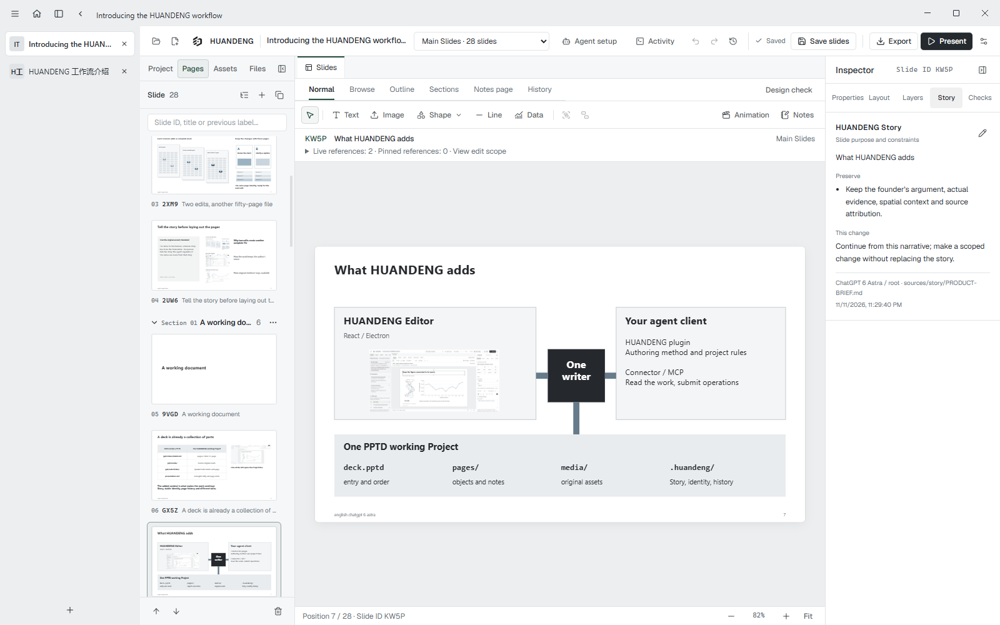
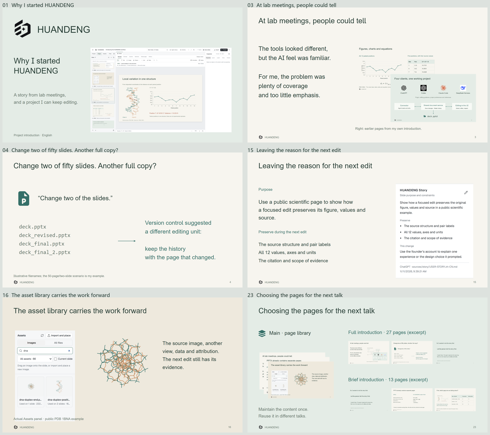

# HUANDENG

English | [简体中文](README.zh-CN.md)

**Slides you can keep working on.**

HUANDENG is an open-source desktop presentation editor built for people who revise their work with AI assistants. Instead of generating another disposable deck, you keep the story, editable pages, original figures, speaking notes and changes together in one local project.

[Download for Windows](https://github.com/JaytonKogeru/huandeng/releases/latest) | [Explore editable examples](examples/huandeng-introduction/README.md) | [Connect an assistant](plugins/huandeng/README.md)



## Why HUANDENG exists

An AI can make a presentation that looks finished but misses what you meant to say. A week later, you change two slides in a fifty-slide research talk and end up with another copy of the entire deck. The next editor loses the reasoning behind the original work.

HUANDENG started from that problem. **The author keeps control of the story; the editor and assistants help the work continue.** Read the [original account](examples/huandeng-introduction/story/USER-STORY.zh-CN.md).

## What makes it different

- **Edit a page without rebuilding the deck.** Pages have stable identities, focused editing tools, saved changes and named versions you can revisit.
- **Keep intent beside the artwork.** Story explains why a page exists and what to preserve; Notes contain what you plan to say.
- **Work from original evidence.** Images and other assets stay in the project, with editable placement and crops. Scientific figures do not have to become decorative screenshots.
- **Make different talks from the same pages.** Organize Main Slides into Sections and reusable Presentations, with audience-specific notes or pinned page versions.
- **Collaborate with AI without surrendering review.** Supported assistants can inspect project context, propose targeted changes and save through the same revision-aware document service as the Editor.

## See it in action

The repository includes six editable English and Chinese introductions created with ChatGPT, Claude Code and DeepSeek Harness. They explain the project's origins, architecture, actual Editor workflow and influences through different stories—not six copies of the same tutorial.



[Browse all six example projects](examples/huandeng-introduction/README.md). The examples are real PPTD projects: open them in the Editor to inspect their pages, source media, Story and Notes.

## Get started

1. **Get the application.** Download the current Windows build from [GitHub Releases](https://github.com/JaytonKogeru/huandeng/releases/latest). Extract the complete folder and run `HUANDENG Editor.exe`.
2. **Open a project.** Choose a `.pptd` entry or a project folder on Home. For a ready-made example, open `examples/huandeng-introduction/chatgpt-en/deck.pptd` from a cloned or downloaded repository.
3. **Make a useful change.** Select a page, read its Story, edit an object and save. Check its History, then arrange the pages you need into a Presentation.

To run from source, use Node.js 22.12+ and Corepack:

```sh
git clone https://github.com/JaytonKogeru/huandeng.git
cd huandeng
corepack pnpm install --frozen-lockfile
corepack pnpm --filter @open-slide/core build
corepack pnpm desktop
```

[Desktop setup](packages/desktop/README.md) | [Project and Presentation guide](docs/PROJECTS.md) | [Story guide](docs/STORY.md)

## One project, shared by people and assistants

A PPTD project is a **folder**, not just a file. Its `.pptd` entry points to editable pages; nearby files hold original media, Story, Presentation arrangements, instructions and named versions. Keep that folder together when moving it. The Editor can also export a **complete editable project ZIP** for handoff.

Behind the interface, Electron hosts the desktop workspace, React provides the canvas, and each project has a local document service. The Editor, CLI and connected AI clients use that service's shared writer; revision checks prevent silently overwriting stale edits.

AI connections are available for **Claude Code, Codex and DeepSeek Harness**, with ChatGPT supported through an authorized workstation connection. Installation and permissions are explained in the [plugin guide](plugins/huandeng/README.md); a configured connection is not a substitute for reviewing the result.

[Architecture and document model](docs/SPEC.md) | [Project folder format](docs/PROJECT-FOLDERS.md) | [AI authoring workflow](plugins/huandeng/skills/huandeng-story/SKILL.md)

## Export and current boundaries

Export to **PPTX, PDF, PNG**, supported **MP4** video, or a full editable project **ZIP**. Supported objects can remain editable in PowerPoint; some elements use documented fallbacks. HUANDENG does **not** currently offer arbitrary PPTX import and round-trip editing. Check exported files in their intended viewer.

[PowerPoint compatibility](docs/POWERPOINT-COMPARISON.md) | [Scientific objects](docs/SCIENTIFIC-OBJECTS.md) | [Release notes](https://github.com/JaytonKogeru/huandeng/releases)

## Open source and acknowledgments

HUANDENG builds on [OpenSlide](https://github.com/open-slide/open-slide) and preserves its MIT licensing and attribution. Reused equation-conversion code from [OpenPPTD](https://github.com/Shingwha/open-pptd), [PptxGenJS](https://github.com/gitbrent/PptxGenJS), and other dependencies are credited in the repository. Its design was also informed by PowerPoint, WPS, Kimi, PPTist, Slidev, Presenton and many other tools. Design references are distinguished from reused code.

See the [complete acknowledgments](docs/ACKNOWLEDGMENTS.md), [third-party notices](packages/desktop/NOTICE.md) and [license](LICENSE). Example images and brand marks retain their own source and usage terms.

Contributions and bilingual feedback are welcome. Start with [CONTRIBUTING.md](CONTRIBUTING.md); report security issues through [SECURITY.md](SECURITY.md).
