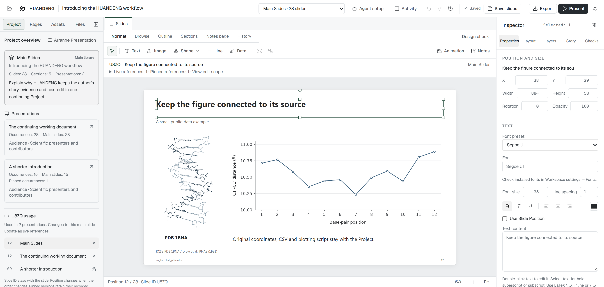
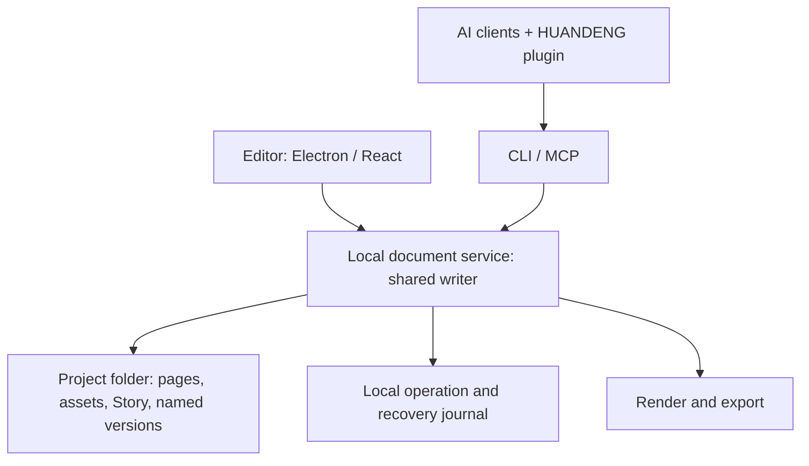

# HUANDENG Editor

English | [简体中文](README.zh-CN.md)

**A desktop slide editor where you and your AI assistants work on the same local project.**

Open a page, select an object, make a focused change, and keep the work that still matters. HUANDENG brings the canvas, original assets, page intent, speaking notes and named versions into one project folder. Reuse those pages in different talks, with the notes and version choices each audience needs.



[Try the editable examples](examples/huandeng-introduction/README.md) | [Desktop setup](packages/desktop/README.md) | [Connect an assistant](plugins/huandeng/README.md) | [Contribute](CONTRIBUTING.md)

The current local Editor and plugin candidate is **0.21.0**, with page actions in Browse and Outline, visible agent progress on individual pages, and reference links in native exports. The Windows package and both client-package forms have been built and checked; see the [0.21 candidate notes](docs/RELEASE-V021.md). This local candidate has not been published as a public release. HUANDENG builds on OpenSlide and retains its MIT license and attribution.

The screenshot above records a real 0.19 working project. The current features described below are newer than that capture; its version label is preserved.

## Why HUANDENG

The project began with a researcher's recurring frustrations: slides that looked complete but missed the speaker's point, and a small revision that produced another copy of an entire deck. The [founder's spoken account](examples/huandeng-introduction/story/USER-STORY.zh-CN.md) starts from group meetings and the wish to keep working with agents while retaining the author's own judgment.

That experience shapes the workflow. Tell the story first, keep original evidence close, and give each page an identity and history. The Editor makes the work visible and editable; plugins give assistants the context and operations to continue it. The author decides what matters and reviews the actual result. The [introduction specification](docs/INTRODUCTION-STORY-SPEC.md) connects those motives to practical demonstrations and acknowledgments.

## Make your first useful edit

1. Open a complete example project from Home, such as `examples/huandeng-introduction/chatgpt-en/deck.pptd`.
2. Choose a page in **Pages** and read its **Story**: what it should explain and what must be preserved.
3. Select a text object on the canvas. In **Properties**, edit **Text content**, then inspect the result in the context of the whole page.
4. Choose **Save slides** or press **Ctrl+S**. Inspect the saved operation and the objects it changed.
5. Record a named page version when you have a result worth keeping.
6. From **Project**, arrange a Presentation using the pages you want to speak about. Save the project, rehearse the selected talk, then check the format and range in **Export**.

The [example collection](examples/huandeng-introduction/README.md) contains editable English and Chinese introductions by ChatGPT, Claude Code and DeepSeek Harness. Their stories explain the project and incorporate real editing tasks; they need not use the same page sequence.

## Get started

### Use a desktop build

Extract the complete Windows desktop package and run **HUANDENG Editor.exe**. Keep the application folder together. Home can create a new project or open an existing `.pptd`; opening a folder works when it has one unambiguous project entry.

A new project starts with one blank page. Add text or shapes on the canvas, and use **Assets → Import and place** for an image. The [desktop guide](packages/desktop/README.md) covers packaging, shortcuts and project windows. The current Windows candidate is prepared at `dist/HUANDENG-v0.21.0-win32-x64`; the [0.21 candidate notes](docs/RELEASE-V021.md) describe its changes and checks. The [0.19 release notes](docs/RELEASE-V019.md) remain the record of that earlier milestone.

### Run from source

Use **Node.js 22.12 or newer** and the repository's pinned **pnpm 10.17.0**:

```sh
git clone https://github.com/JaytonKogeru/huandeng.git
cd huandeng
corepack pnpm install --frozen-lockfile
corepack pnpm --filter @open-slide/core build
corepack pnpm desktop
```

The core build also produces the Editor frontend. Set `HUANDENG_DEV_SERVER=1` before starting the desktop when you need frontend hot reload. PNG and PDF rendering require Chromium, Chrome or Edge; `HUANDENG_BROWSER` can select the browser. The Windows workflow can use the installed Edge.

To package the desktop and create current-user shortcuts:

```powershell
powershell -NoProfile -File scripts/Package-Huandeng.ps1
powershell -NoProfile -File scripts/Install-Huandeng.ps1
```

The desktop host uses Electron 38.7.2. See the [build options](packages/desktop/README.md) before replacing an existing application directory.

## A story-led authoring workflow

For slide work in this repository, use **Audit, Spec, Implement, Validate, Release**. A useful edit begins with the author's intent and existing evidence, then develops into a visual explanation the author can keep working on.

| Stage | Work to complete |
| --- | --- |
| Audit | Read the source story, project instructions, existing pages and real rendered output. Understand what to preserve and what is failing. |
| Spec | Organize the argument, weave teaching into the story, and design representative pages around their evidence. |
| Implement | Make focused changes through the shared writer; retain original material, page identity and meaningful history. |
| Validate | Inspect every affected page and the complete sequence, including visual meaning, UI orientation, Notes and the exported result. |
| Release | Save the usable project and requested delivery formats, with accurate sources and a record of what was verified. |

The [authoring contract](docs/INTRODUCTION-STORY-SPEC.md) applies this process to the introduction examples. Technical checks help find problems; actual visual review determines whether the explanation works. Scientific plots should come from suitable plotting tools and retain their data and source context.

## How the work fits together

| Your task | Where to do it |
| --- | --- |
| Change wording, layout or an image crop | Select the object on the canvas; use Properties and Layers. |
| Find and reuse an original | Search Assets by filename, inspect its uses, and drag it onto the page. |
| Explain what a page should achieve | Write its purpose, what to preserve and the requested change in Story. |
| Prepare the spoken explanation | Write Notes; use Notes page to read the script beside the slide. |
| Inspect sequence and density | Switch to Browse or Outline; organize continuous ranges in Sections. |
| Return to a meaningful earlier result | Name a page version, inspect its History preview, then restore or reuse it. |
| Adapt the material to another audience | Arrange a Presentation from Main pages or Sections. |
| Deliver the talk | Rehearse the selected collection; confirm Export's format and range. |

### Page actions where you are working

In **Browse** or **Outline**, right-click a page or use its **More actions** button. Keyboard users can focus the page and press **Shift+F10**. Open the page, start presenting from that appearance, read its Story or Notes, inspect History, copy its Slide code, or find its source in Files.

For Main Slides, **Organize Slide** inserts a blank before or after the page, duplicates it, or changes its order. Hide/show and **Remove from Main** are separate actions. In a Presentation, the menu takes you to the Main Slide or the Presentation arrangement; pinned versions retain their read-only artwork. Actions use the page you opened the menu on and respect unsaved edits.

### One page library, several talks

**Main Slides** is the project's page library. Each page has a permanent identity and a short Slide ID. Its position can change without changing that identity.

A **Section** begins at a selected Main page and ends before the next Section starts. Browse, Outline and Sections offer different ways to inspect the same sequence.

A **Presentation** selects references from Main for a particular talk. A page can appear more than once; each occurrence can have its own speaking notes. A live reference follows later Main edits. A pinned reference keeps a named page version. To configure notes or a version separately for pages inside a Section reference, expand that reference into individual page occurrences.

Save page edits with **Save slides**; save structural changes in the project arrangement with **Save project**. The [project guide](docs/PROJECTS.md) explains these relationships and their editing rules.

### Context that stays with the work

Story records why the project, a Section, a Presentation or a page exists. Page Story also preserves editing constraints. Notes hold what the speaker will say. An assistant can read this context together with neighboring pages and asset information before proposing a change.

Open **Project rules** in **Project** to read the canonical root `AGENTS.md` text and its source. Open the full file in the workspace preview or refresh the rules after editing it. The view preserves the author's instructions instead of creating a second rule set or substituting an AI summary.

Assets preserve original file bytes and expose their uses in the project. Display crops are editable image properties. Named page versions archive the page and its referenced local assets, so a recorded result can travel with the project folder.

Automatic saves, recorded operations, named page versions and Git commits serve different purposes. Named versions travel with the project; the installation's operation and recovery logs remain local. See [Story](docs/STORY.md), [project folders](docs/PROJECT-FOLDERS.md) and the [versioning policy](docs/RELEASE-POLICY.md).

## Work with an assistant

Open **Agent setup** in the Editor, choose your client, follow its configuration steps, and verify the target project before requesting an edit.

For DeepSeek Harness, start with the **native plugin** route and install the bundle through its Plugin Manager. The generated configuration targets the existing `huandeng` plugin entry. The separately labelled legacy MCP patch is for profiles without that native bundle; use one route per profile. Configuration generation preserves account and model settings.

| Client | Integration maintained in this repository |
| --- | --- |
| Claude Code | Native manifests at `plugins/huandeng/.claude-plugin/plugin.json` and `plugins/huandeng/.mcp.json`, with `plugins/huandeng/skills/`. |
| DeepSeek Harness | Native Cordis adapter at `plugins/huandeng/adapters/deepseek/`, including host lifecycle and per-project routing, packaged with the shared skill and launcher. |
| Codex | The portable plugin, compatibility manifest or generated MCP TOML configuration. |
| ChatGPT | The same local CLI through an authorized workstation connection; account bindings stay separate from the public package. |

Start with the [plugin guide](plugins/huandeng/README.md) or [DeepSeek native adapter](plugins/huandeng/adapters/deepseek/README.md). Both package forms are maintained in this engineering repository. Build them from the repository root, choosing a new output directory for each build:

```sh
node plugins/huandeng/scripts/build-package.mjs --target local --output "$PWD/dist/plugin-packages/local-build"
node plugins/huandeng/scripts/build-deepseek.mjs --output "$PWD/dist/plugin-packages/deepseek-build"
```

Each command creates a `huandeng/` package inside its output directory. The current local candidate packages are `dist/plugin-packages/0.21.0/portable-claude-codex/huandeng` and `dist/plugin-packages/0.21.0/deepseek-native/huandeng`. Both are inside this engineering project. Generated packages are build outputs; the maintained source is `plugins/huandeng`. Use the client's supported plugin loader or manager to install the appropriate form.

The packaged MCP reports 0.21.0 and retains the 24-tool surface, including project-bound original-image import and real Editor capture. Progress reports can include the assistant family, workflow stage and page scope. Compatible older writers receive the legacy report fields, with unsupported optional fields identified in the response. Current runtime and package checks are recorded in the [candidate notes](docs/RELEASE-V021.md).

The [0.20 native integration record](docs/NATIVE-INTEGRATION-0.20.md) distinguishes actual DeepSeek model tool calls, Claude Code's connected plugin, the host-denied Chinese MCP request, and completed native CLI authoring. It also records the saved examples and independent Office checks. The [0.19 integration record](docs/NATIVE-INTEGRATION-0.19.md) remains dated history; a package manifest or connected label alone does not establish a completed model task.

The shared [huandeng-story skill](plugins/huandeng/skills/huandeng-story/SKILL.md) reads the author's source material and existing pages, develops the argument and visual treatment, previews the proposed changes, then inspects the saved result and real rendering.

For example, the CLI can inspect the same project:

```sh
node packages/core/huandeng.js --entry examples/huandeng-introduction/chatgpt-en/deck.pptd inspect
node packages/core/huandeng.js --entry examples/huandeng-introduction/chatgpt-en/deck.pptd quality --language en
```

Edits use current page identities and revisions, followed by preview, apply and saved-result review. Do not copy stale IDs or revisions into a new task. Runtime guides `huandeng://guide/story` and `huandeng://guide/operations` describe the workflow.

### See reported work on a page

Page badges identify recent work reported by **ChatGPT / Codex**, **Claude / Claude Code** or **DeepSeek Harness**, with its current stage and report time. Click a badge to open Activity and inspect the task and any verified saved changes. Multiple tasks can be shown on the same page; the badge does not lock it.

Progress comes from the assistant's reports. After **five minutes** without an update, a task is marked **Not recently updated**; its page badge disappears after **thirty minutes** without an update. Completed, failed or stopped task badges remain for **two minutes**, with the record retained in Activity. Reports from a previous writer session are stale. A reported task outcome and a matching writer save receipt remain separate evidence.

Identity slots for pi, Zcode / GLM, WorkBuddy, Grokbot / Grok, Gemini, Antigravity and Hermes are reserved for future integrations. They do not indicate an installed connection.

## Architecture

Electron provides desktop windows, file dialogs and project tabs. The React Editor provides the canvas and workspace. Each open project has a local document service; the Editor, CLI and MCP clients submit revision-aware changes to its shared writer.



A stale revision produces a conflict, so the client must read the current state and form an updated proposal. Different pages can be assigned to different collaborators. Changes to the same page or shared project structure need coordination. A task label is not a lock or an automatic agent scheduler. See the [document specification](docs/SPEC.md) and [collaboration evidence](docs/NATIVE-INTEGRATION-0.19.md).

### The editable project is a folder

| Path | Purpose |
| --- | --- |
| `deck.pptd` or another named entry | Main page references and order. |
| `pages/*.page` | Editable page objects and notes. |
| `media/`, `assets/` and other referenced asset paths | Original and reused project material. |
| `.huandeng/project.json` | Stable identities, Story, Sections and Presentation arrangements. |
| `.huandeng/checkpoints/`, `media/.huandeng-versions/` | Named page versions and their archived assets. |
| `AGENTS.md` | The author's editable project instructions. |
| `Exports/` | Delivery files and export reports. |

**Send the whole project folder when someone will continue editing.** A `.pptd` entry alone leaves referenced pages and assets behind. A PDF or PPTX is a delivery format; the working folder preserves the HUANDENG editing context.

## Where it helps

- **Research and weekly progress reviews:** retain original figures and edit only the claims or results that changed.
- **Teaching and technical training:** keep the spoken explanation in Notes, arrange the sequence for the audience and rehearse click steps.
- **Repeated presentations:** build a short talk and a full walkthrough from the same page library, with deliberate version choices.
- **Human–assistant collaboration:** assign a concrete page or section, retain its intent, inspect the exact saved change and review the finished visual.

## Formats and current limits

HUANDENG supports text, images, shapes, lines, icons, groups, native tables and charts, and LaTeX equations. Supported objects export as editable PPTX structures; the export report identifies fallbacks and warnings. See [scientific objects](docs/SCIENTIFIC-OBJECTS.md) and [PowerPoint compatibility](docs/POWERPOINT-COMPARISON.md).

Safe links in rich text and table cells retain real destinations in PDF and editable PPTX text. Clicking those labels while editing keeps you in the document; use the exported file to follow its references.

PNG, PDF and PPTX export the static base layout. Editor click steps do not become PowerPoint animations. MP4 is a separate silent timed export that requires FFmpeg with libx264 and has its own supported-material limits.

The current Editor does not provide arbitrary PPTX import and round-trip editing, direct Google Slides editing, a separate dual-screen presenter window, inherited master slides or an Editor plugin marketplace. Fonts and Office layout can affect delivery, so inspect the output in its target viewer.

## Develop and contribute

| Directory | Contents |
| --- | --- |
| `packages/core` | Editor, PPTD document service, CLI / MCP, rendering and export. |
| `packages/desktop` | Electron host and project lifecycle. |
| `plugins/huandeng` | Client manifests, shared authoring skill, launchers and native DeepSeek adapter. |
| `examples` | Editable examples, tutorials and source material. |
| `docs` | Product contracts, architecture, workflows and release records. |
| `scripts` | Packaging, installation and focused verification tools. |

Read [CONTRIBUTING.md](CONTRIBUTING.md) for setup, checks and pull requests. English and Chinese issues are welcome. For security reports, follow [SECURITY.md](SECURITY.md); community participation follows the [Code of Conduct](CODE_OF_CONDUCT.md).

Run checks that match the change. The normal core CI includes Biome, core type checking, unit tests and a core build. Visual changes also need real rendering; integration changes need the relevant host. The [release policy](docs/RELEASE-POLICY.md) separates Editor and plugin milestones from inherited npm package versions.

## License and acknowledgments

HUANDENG builds on [OpenSlide](https://github.com/open-slide/open-slide). Its MIT license and original copyright notice are preserved in [LICENSE](LICENSE); the [upstream README](docs/UPSTREAM_README.md) remains available. HUANDENG is this project's product name, while existing `@open-slide/*` package names remain compatibility identifiers.

Apache ECharts supplies charts, KaTeX supplies mathematical layout, Font Awesome Free supplies icons, and PptxGenJS supplies PowerPoint generation. The separately attributed OpenPPTD conversion modules support equation export. See [third-party notices](packages/desktop/NOTICE.md) and the [OpenPPTD notice](packages/core/src/pptd/vendor/open-pptd/NOTICE.md).

The [complete acknowledgments and design references](docs/ACKNOWLEDGMENTS.md) explain the original fifteen introduction credits and the full thirty-three-item research inventory. They include PowerPoint, WPS, Kimi, PPTist, Slidev, Presenton, PPTAgent, PPT Master, open-kimi-ppt-skill, OpenSlides Studio, OPF and VS Code, with the specific ideas each contributed. OpenSlides Studio is separate from the OpenSlide codebase.

Figures, brand marks and other example assets retain their own source and license terms. The software license does not relicense those materials. Their [source records](examples/huandeng-introduction/README.md) stay with the editable examples.
