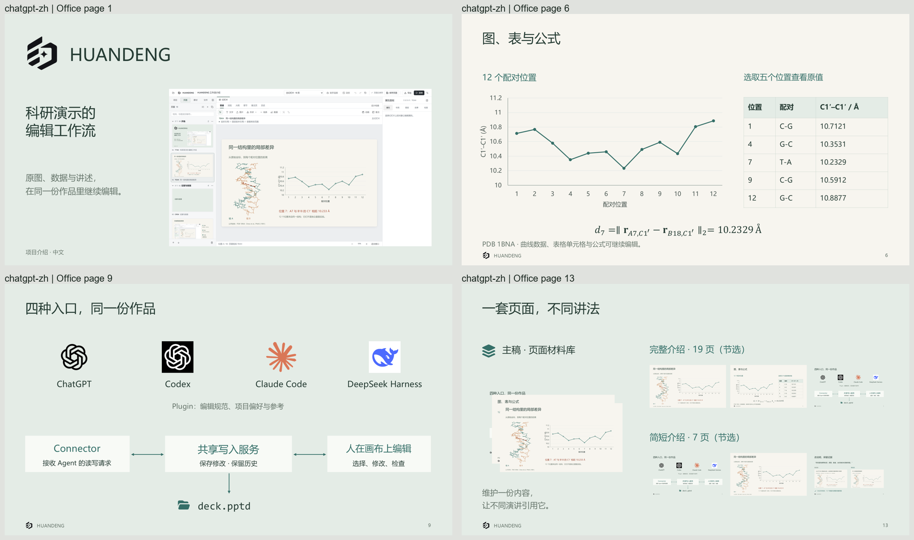

# HUANDENG 幻灯

[English](README.md) | 简体中文

**让幻灯片成为一份可以不断修改、继续讲述的作品。**

HUANDENG 是一款开源桌面幻灯片编辑器。你和 AI 助手在**同一个本地项目**中工作：原始图片、可编辑页面、讲述意图、演讲备注以及修改历史都留在一起，而不是每改一次就重新生成整份 PPT。

[下载 Windows 版](https://github.com/JaytonKogeru/huandeng/releases/latest) | [查看可编辑示例](examples/huandeng-introduction/README.md) | [连接 AI 助手](plugins/huandeng/README.md)


## 我们为什么做它

AI 可以做出看起来完整的幻灯片，却不一定知道你真正想讲什么。下一次组会，五十页只想改两页，却又多了一份完整文件。换一个人或助手接手，还得重新解释原来的判断和素材。

HUANDENG 就从这些问题开始。**故事由作者决定；工具和 AI 负责让这份工作持续下去。** 这条产品起点来自[作者的真实经历](examples/huandeng-introduction/story/USER-STORY.zh-CN.md)。

## 有什么不同

- **改一页，不必重做整份。** 每页有稳定身份，可以局部编辑、检查已保存的改动，也可以随时回到命名版本。
- **把讲述意图留在页面旁。** Story 记录这页为什么存在、哪些内容不能丢；Notes 留下真正要讲的话。
- **原始素材不离开项目。** 图片、数据图和其他资源可继续使用，画布上的位置与裁切可以调整，而不必把所有证据变成装饰图。
- **一套页面，组织多场演讲。** Main Slides 是页面库；Section 负责组织章节，Presentation 为不同听众选择页面、备注和固定版本。
- **AI 可以协作，但修改必须可检查。** 助手读取项目上下文，通过同一文档服务提交有版本依据的修改；最终内容仍由人确认。

## 看看实际做出来的东西

仓库里有 ChatGPT、Claude Code、DeepSeek Harness 分别制作的六套中英文**可编辑介绍项目**。它们用不同的故事解释 HUANDENG 的起源、架构、Editor 操作与设计参考，而不是六份结构相同的按钮教程。



[查看六套完整示例](examples/huandeng-introduction/README.md)。这些不是图片合集：用 HUANDENG 打开对应 PPTD，就能继续查看页面、原始素材、Story、Notes 和历史。

## 开始使用

1. **下载编辑器。** 从 [GitHub Releases](https://github.com/JaytonKogeru/huandeng/releases/latest) 获取最新版 Windows 应用，完整解压文件夹，然后运行 `HUANDENG Editor.exe`。
2. **打开或新建项目。** 在首页选择 `.pptd` 入口或项目文件夹，或者新建空白项目、三页可编辑练习。填写名称和父文件夹后，界面会显示最终项目入口；也可以从仓库打开 `examples/huandeng-introduction/chatgpt-zh/deck.pptd`。
3. **先改一处。** 选中页面，读一下 Story，修改画布对象并保存。随后去历史里查看这次修改，再用需要的页面组织一场 Presentation。

也可以使用 Node.js 22.12+ 与 Corepack 从源码启动：

```sh
git clone https://github.com/JaytonKogeru/huandeng.git
cd huandeng
corepack pnpm install --frozen-lockfile
corepack pnpm --filter @open-slide/core build
corepack pnpm desktop
```

[桌面安装说明](packages/desktop/README.md) | [项目和演讲组织](docs/PROJECTS.md) | [Story 使用说明](docs/STORY.md)

## 一个项目，人与助手共用

PPTD 项目本质上是**一个文件夹**，而不只是单个文件。入口 `.pptd` 管理页面顺序，旁边保存可编辑页面、原始素材、Story、演讲编排、创作约定和命名版本。移动时保留整个文件夹，也可以用编辑器导出**可编辑项目 ZIP**交给别人继续做。

桌面应用由 Electron 承载，React 提供可视化编辑界面。每个项目都有本地文档服务，Editor、CLI 和已连接的 AI 客户端通过同一套 Writer 修改文件；版本检查可以阻止过时的修改悄悄覆盖新内容。

目前支持 **Claude Code、Codex、DeepSeek Harness** 的插件接入；ChatGPT 可以通过已授权的工作站连接调用同一工具。具体安装、权限及配置见 [Plugin 指南](plugins/huandeng/README.md)。连接成功不等于作品合格，仍需检查真实结果。

需要先看方案时，让助手提交待审方案，在 Activity 中比较实际页面后接受。保存冲突也可并排比较、合并独立字段，并恢复暂存草稿。参见[审阅方案与保存冲突](docs/PROPOSAL-REVIEW.md)。

[架构与文档模型](docs/SPEC.md) | [项目目录格式](docs/PROJECT-FOLDERS.md) | [AI 创作流程](plugins/huandeng/skills/huandeng-story/SKILL.md)

## 导出与边界

可以导出 **PPTX、PDF、PNG**、受支持的 **MP4** 视频，或完整的**可编辑项目 ZIP**。支持的对象可以保留为 PowerPoint 可编辑元素；部分内容会有明确的兼容回退。当前**不支持任意 PPTX 文件导入后完整往返编辑**，正式交付前应在目标软件中检查成品。

[PowerPoint 兼容性](docs/POWERPOINT-COMPARISON.md) | [科研对象支持](docs/SCIENTIFIC-OBJECTS.md) | [更新记录](https://github.com/JaytonKogeru/huandeng/releases)

## 开源与致谢

HUANDENG 基于 [OpenSlide](https://github.com/open-slide/open-slide) 的编辑基础开发，保留其 MIT 许可证及原作者归因。公式转换复用了 [OpenPPTD](https://github.com/Shingwha/open-pptd) 的相关模块，PowerPoint 输出使用 [PptxGenJS](https://github.com/gitbrent/PptxGenJS)。设计过程还研究了 PowerPoint、WPS、Kimi、PPTist、Slidev、Presenton 等工具；**借鉴设计与复用代码是两回事**。

完整来源见[致谢与设计参考](docs/ACKNOWLEDGMENTS.md)、[第三方声明](packages/desktop/NOTICE.md)和[许可证](LICENSE)。示例中的科研图片、品牌标识和截图仍遵守各自的来源及使用条件。

欢迎中英文反馈和贡献。开发与提交方式见 [CONTRIBUTING.md](CONTRIBUTING.md)，安全问题通过 [SECURITY.md](SECURITY.md) 的渠道报告。
