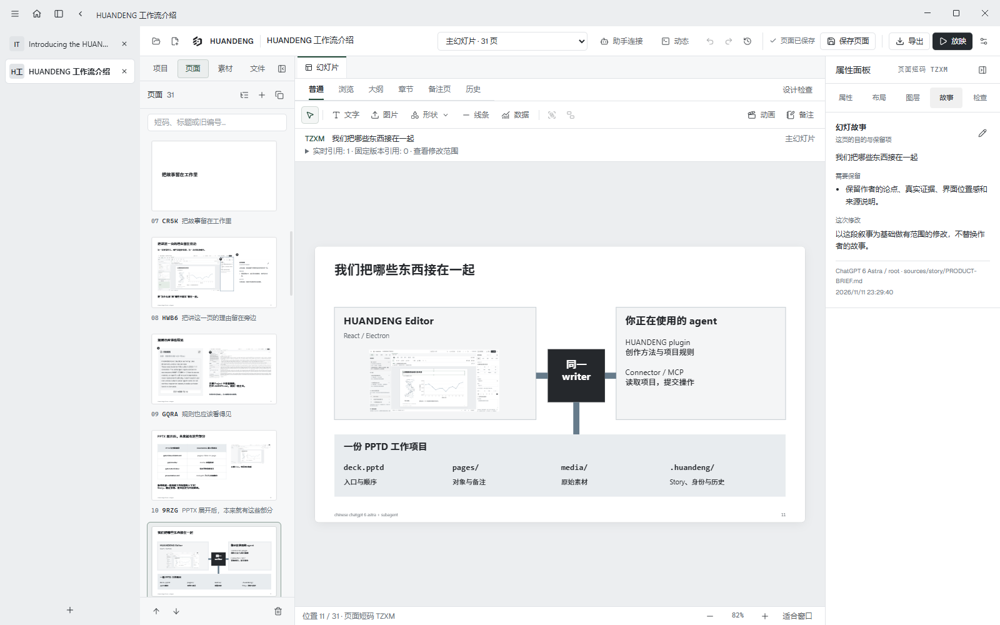
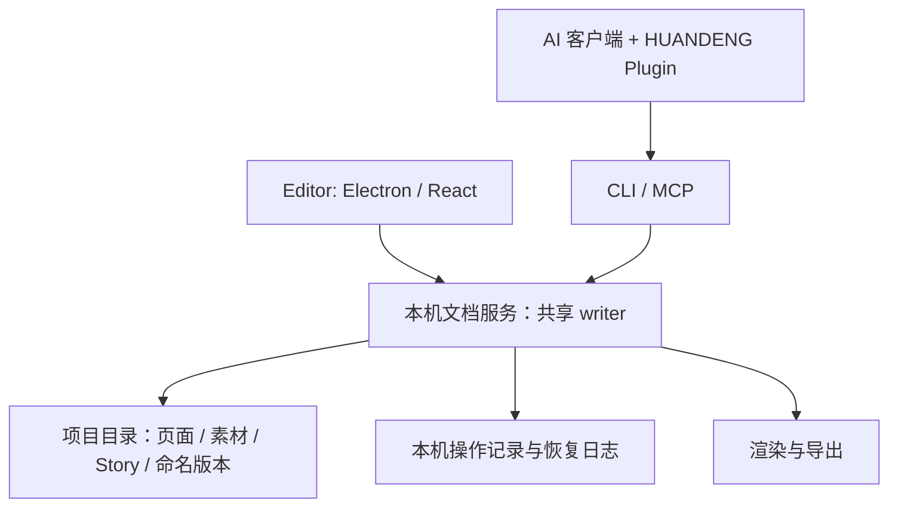

# HUANDENG Editor

[English](README.md) | 简体中文

**把幻灯片做成可以持续修改、重复使用，并能与 AI 助手共同编辑的项目。**

HUANDENG 是一个本地桌面幻灯片编辑器。你在画布里选对象、改文字、放原图；助手通过同一个文档服务读取和修改同一份项目。每一页都有稳定身份，可以留下讲述意图、查看修改记录、保存命名版本，再被不同演讲重复引用。它适合需要不断更新内容的研究汇报、教学、技术说明和产品演示。



**0.22.2** 修复了切换项目时界面主题不一致的问题：现在所有项目、顶部标题栏与 Home 共用全局主题；保留 0.22 的可拖动横向／竖向标签栏与可编辑项目 ZIP 导出。Windows 应用和 Claude Code/Codex、DeepSeek 插件包可从 [GitHub Releases](https://github.com/JaytonKogeru/huandeng/releases/tag/editor-v0.22.2) 下载。参见 [0.22.2 修复说明](docs/RELEASE-V0222.md) 与 [0.22 功能说明](docs/RELEASE-V022.md)。

上图来自实际的 0.22 桌面窗口，打开的是本仓库可继续编辑的中文介绍项目。左侧是垂直项目标签，画布旁保留当前页面的 Story。

[打开产品介绍示例](examples/huandeng-introduction/README.md) | [桌面启动与打包](packages/desktop/README.md) | [助手接入](plugins/huandeng/README.md) | [0.22 发布说明](docs/RELEASE-V022.md)

## 为什么做幻灯

这个项目从组会里的两个困扰开始：AI 做出的页面看起来完整，却没有表达讲者真正的重点；五十页只改两页，又得到一整套新文件。作者仍然希望让 agent 帮忙，同时保留自己的讲法、原图和修改判断。[原始口述故事](examples/huandeng-introduction/story/USER-STORY.zh-CN.md)记录了这条起点。

因此，幻灯把故事放在排页之前，把一页作为可以识别、修改和回看的单位。Editor 让人看见并编辑作品，Plugin 帮助手理解上下文、操作同一份项目；原始素材、Story、备注和历史留在工作旁边。作者决定该讲什么，也亲自判断实际画面。介绍示例把这些动机、架构和实际操作组织成一个故事，具体约定见[叙事规格](docs/INTRODUCTION-STORY-SPEC.md)。

## 先做一处修改

1. 打开 HUANDENG，在 Home 选择新建项目，或打开已有的 `.pptd` 文件。也可以选择直接包含一个 `.pptd` 的项目文件夹。
2. 在左侧「页面」选一页；需要空白页时，点页面栏的 **＋「新增页面」**。选中文字工具，在画布点击或拖拽放置文字；已有对象直接点选。
3. 在「素材」里按文件名找到原图并拖到画布。新图片用 **「导入并放置」**；右侧属性调整大小、位置和裁切。
4. 打开右侧 **Story**，记下这页要说明什么、哪些内容需要保留、这次具体改哪里。讲给听众的完整解释写入 **Notes / 备注**。
5. 检查画布，点击 **「保存页面」**，或按 **Ctrl+S**，确认显示「页面已保存」。章节和演讲编排在相应面板点击 **「保存项目」**。
6. 在需要保留的节点，打开当前页历史并记录一个命名版本。之后可以继续编辑当前页，也可以为某场演讲固定使用这个版本。

可以从[中文入门项目](examples/huandeng-introduction/chatgpt-zh/deck.pptd)开始练习。请保留或下载整个项目文件夹：`.pptd` 是入口，页面、素材和命名版本在它旁边。更多入口规则见[项目文件夹](docs/PROJECT-FOLDERS.md)。

## 适合怎样的工作

| 工作 | HUANDENG 中的做法 |
| --- | --- |
| 每周组会或研究进展更新 | 保留原图、Story 和稳定 Slide ID，只修改这次有变化的页面。 |
| 同一批内容面向不同听众 | 从 Main Slides 选页或选章，组织成不同 Presentation；可为每次引用写不同讲稿。 |
| 课程、培训和技术演示 | 用备注组织讲述，用对象点击步骤安排出场，再预演整场顺序。 |
| 与一个或多个 AI 助手合作 | 明确项目和页面，先看修改影响，再通过共享 writer 保存、回读并检查实际画面。 |

这些工作可以在同一套项目结构中组合。例如，一页研究结果留在 Main 中，组会直接引用最新版；已经讲过的短报告则固定到某个命名版本。详见[项目与演讲](docs/PROJECTS.md)。

## 快速开始

### 使用 Windows 桌面包

下载 [Windows ZIP](https://github.com/JaytonKogeru/huandeng/releases/download/editor-v0.22.2/HUANDENG-Editor-0.22.2-win32-x64.zip)，完整解压后运行 **HUANDENG Editor.exe**。整个应用目录需要一起保留，不能只复制一个 `.exe`。变化与验证见 [0.22 发布说明](docs/RELEASE-V022.md)，构建和快捷方式安装方法见[桌面说明](packages/desktop/README.md)。

首次启动在 Home 新建或打开项目；之后可以恢复最近打开的项目标签页。同一项目再次打开会回到已有标签页。新建项目会建立独立文件夹、入口文件、一张空白页和 `AGENTS.md` 创作约定。已有文件夹若包含多个入口，请明确选择其中一个 `.pptd`。[桌面说明](packages/desktop/README.md)

### 从源码启动

推荐使用 **Node.js 22.12 或更新版本**与仓库锁定的 **pnpm 10.17.0**：

```sh
git clone https://github.com/JaytonKogeru/huandeng.git
cd huandeng
corepack pnpm install --frozen-lockfile
corepack pnpm --filter @open-slide/core build
corepack pnpm desktop
```

core build 同时生成编辑器前端。开发时需要前端热更新，可设置 `HUANDENG_DEV_SERVER=1` 再启动。桌面宿主固定使用 Electron 38.7.2；Windows 打包和当前用户快捷方式安装使用仓库脚本：

```powershell
powershell -NoProfile -File scripts/Package-Huandeng.ps1
powershell -NoProfile -File scripts/Install-Huandeng.ps1
```

详细依赖与打包选项见[桌面说明](packages/desktop/README.md)。PNG / PDF 输出需要 Chromium、Chrome 或 Edge；可通过 `HUANDENG_BROWSER` 指定浏览器。Windows 默认可使用 Edge。

## 按自己的习惯安排工作区

拖动项目标签即可调整顺序。标签栏上的布局按钮，以及「工作区设置」，都可以在顶部横排和左侧竖排之间切换；竖排还可以折叠成窄栏。顺序和显示方式会自动保存。键盘操作可以在标签获得焦点后，用横排的 **Alt+Shift+左/右** 或竖排的 **Alt+Shift+上/下** 调整位置。

工作区设置分成「工作区、编辑、字体」三组。**主题、界面语言、标签栏和吸附属于整个 Editor**，换项目时不应变化；面板显示、宽度与备注停靠位置目前单独按项目记忆。字体检查按需执行，字体预设不会自动安装字体。

## 从故事到成品的工作流程

本仓库的幻灯片创作遵守 **Audit、Spec、Implement、Validate、Release**。先理解作者和已有证据，再组织论证、设计页面，最后检查实际效果与交付结果。

| 阶段 | 要完成的工作 |
| --- | --- |
| Audit：审计 | 读完整原故事、项目约定、历史页面和真实渲染，确定哪些该保留、哪里出了问题。 |
| Spec：设计规格 | 组织完整叙事，把教学放在有动机的位置，围绕证据设计有代表性的页面。 |
| Implement：实现 | 通过共享 writer 做明确修改，保留原材料、页面身份与有意义的历史。 |
| Validate：核验 | 看每张受影响页面和完整顺序，检查视觉关系、界面位置引导、讲稿与导出画面。 |
| Release：交付 | 保存可继续使用的项目、所需交付格式、准确来源和实际核验结果。 |

[介绍项目的创作约定](docs/INTRODUCTION-STORY-SPEC.md)具体说明这些阶段。技术检查帮助发现问题，实际视觉审查负责判断讲解是否成立；科学数据图应使用合适的专业绘图工具，保留数据、单位和来源，再放进编辑器。

## 从一页，组织成一场演讲

**Main Slides 是项目的页面库。** 页面的永久 ID 和界面里的短 Slide ID 用于认出同一页；Position 表示它当前排在哪里。重排页面会改变位置，不会改变页面身份。需要跟同事或助手讨论某页时，可以复制 Slide ID。[位置与身份](docs/POSITION-FIELDS.md)

**Section 组织 Main 的连续内容。** 选定一张 First Slide，章节延伸到下一章节的起点之前；保存的是稳定页面边界。编辑章节后保存项目。浏览、大纲和章节视图帮助检查整体结构，同时保留画布的编辑状态。[章节规则](docs/PROJECTS.md)

**Presentation 为一次具体讲述选内容。** 新建 Presentation，再用「添加页面或章节」挑选来源，调整顺序并保存项目。默认引用跟随 Main 更新；同一页可以出现多次，每次有自己的备注。需要固定旧画面时，为独立页面引用选择一个命名版本。整章引用要逐页设置备注或版本时，先拆为独立页面引用。[项目与演讲指南](docs/PROJECTS.md)

放映与导出使用当前选中的 Main 或 Presentation。**F5** 从头放映，**Shift+F5** 从当前页开始，**Esc** 退出。对象可以按点击步骤出场，预演与放映使用同一播放模型。交付前核对所选集合、实际顺序和导出报告。[动画与放映](docs/ANIMATION.md)

## Editor 的几个设计选择

### 把「这一页为什么存在」留在页面旁边

Story 记录项目、章节、演讲和单页的目的与约束；Notes 记录实际要讲的话。助手读取这些信息时，也会看到邻页、素材和这页被哪些演讲使用。作者无需在每次对话里重新解释全部背景。Story 是可继续工作的上下文，最终画面仍需要实际检查。[Story 约定](docs/STORY.md)

在「项目」页打开**项目规则**，可以直接查看项目根目录 `AGENTS.md` 的原文和来源，可以打开完整文件预览，也可以在编辑文件后刷新读取。它使用同一份作者约定，不另建一份规则，也不把 AI 摘要当作原文。

### 保留原材料，也保留改动依据

素材库索引项目中的原图和页面使用位置，支持按原文件名查找、预览与复用。导入保留原始文件字节，相同内容可复用同一份素材。操作记录用于查看具体保存；**命名页面版本**记录明确的里程碑，并把当时引用的本地素材一起归档。命名版本随项目文件夹移动，本机操作和恢复日志留在原安装环境。[素材与科研对象](docs/SCIENTIFIC-OBJECTS.md) | [版本规则](docs/RELEASE-POLICY.md)

### 用不同视图处理不同尺度的工作

普通视图处理对象；浏览和大纲检查页面顺序；章节视图处理内容结构；备注页集中写讲稿；历史视图预览与恢复页面版本。左侧导航、右侧属性、图层、Story 和检查面板围绕当前工作对象组织，面板可以收起、调整宽度或停靠。界面语言可以切换中文、英文，页面正文和备注保持作者原文。[工作区说明](docs/WORKSPACE-UX.md)

在**浏览**或**大纲**里，右键一页或点击它旁边的**更多操作**，即可打开页面、从这一处开始放映、查看 Story、备注或历史、复制页面短码，以及在文件中定位来源。键盘用户可以聚焦页面后按 **Shift+F10**。

Main 页面还可以在「组织页面」里插入前后空白页、复制、上下移动，并单独选择隐藏、显示或从 Main 移除。演讲中的菜单提供返回 Main 来源与编排当前演讲的入口，固定版本继续保持只读。操作针对打开菜单的那一页，也会遵守未保存修改的保护。

### 保存结果可以核对

页面修改与项目编排分别保存。助手的进度报告和文档服务的实际保存回执分开显示；保存后的操作可以查看前后画面及变更对象。检查面板可以测量内容范围、检查本机字体，并标明已经过期的结果。它帮助定位问题，不能代替作者的视觉判断或 PowerPoint 中的交付检查。[原生接入与协作记录](docs/NATIVE-INTEGRATION-0.19.md) | [PowerPoint 兼容范围](docs/POWERPOINT-COMPARISON.md)

## 架构：多个入口，一份文档状态

Electron 提供桌面窗口、文件对话框和项目标签页；React 画布负责可视化编辑。每个打开的项目有一个本机文档服务。GUI、CLI 与 MCP 都向这个服务提交带版本条件的修改，由同一个 writer 保存。



过期的页面版本会产生冲突，客户端需要读取新状态再形成修改。不同页面可以分工处理；同一页及共享的 Story、章节、演讲元数据需要协调。任务标签本身不构成锁，也不会自动安排助手。外部程序绕过服务直接改文件，不在这个协作协议中。[协议规格](docs/SPEC.md) | [实际协作验证](docs/NATIVE-INTEGRATION-0.19.md)

### 项目里有什么

| 路径 | 用途 |
| --- | --- |
| `deck.pptd`（入口文件名可以不同） | 项目入口、Main 页面引用和页序。 |
| `pages/*.page` | 可编辑的逐页内容、对象和备注。 |
| `media/`、`assets/` 及其他被引用的素材路径 | 原图与页面使用的素材。 |
| `.huandeng/project.json` | 稳定身份、Story、Section 与 Presentation 编排。 |
| `.huandeng/checkpoints/`、`media/.huandeng-versions/` | 命名页面版本及对应的历史素材。 |
| `AGENTS.md` | 作者可以编辑的项目创作约定。 |
| `Exports/` | 当前交付文件与导出报告。 |

复制或分享项目时，保持整个目录完整。命名页面版本不要求使用 Git；编辑器代码、项目备份和普通页面自动保存也有各自的历史。[项目目录说明](docs/PROJECT-FOLDERS.md)

## 连接你的 AI 助手

在顶栏打开 **「助手连接」**，选择客户端并生成当前项目的配置。把配置加到对应客户端后，读取项目上下文并核对目标项目。生成配置、客户端成功加载、模型完成任务和成品质量是四个需要分别检查的结果。

所有客户端共用仓库中的 [`huandeng-story` 技能](plugins/huandeng/skills/huandeng-story/SKILL.md)与运行时指南。它要求先读作者素材与现有页面，形成故事和设计方向，预览修改，保存后回读并检查实际渲染。[Plugin 指南](plugins/huandeng/README.md)

| 客户端 | 工程内的接入形式 | 入口 |
| --- | --- | --- |
| Claude Code | `plugins/huandeng/.claude-plugin/plugin.json`、`.mcp.json` 与 `skills/` | [本地 Plugin](plugins/huandeng/README.md#claude-code) |
| DeepSeek Harness | `plugins/huandeng/adapters/deepseek/` 的原生 Cordis 适配器，连同共享技能与启动器打包 | [DSH 原生适配器](plugins/huandeng/adapters/deepseek/README.md) |
| Codex | Portable Plugin、兼容 manifest 或生成的 MCP TOML 配置 | [Codex 接入](plugins/huandeng/README.md#codex) |
| ChatGPT | 通过已有授权工作站连接调用同一 CLI；账户绑定独立于公开本地包 | [工作站接入](plugins/huandeng/README.md#chatgpt-through-the-existing-workstation) |

Claude Code 和 DeepSeek Harness 的包都由工程内部的 `plugins/huandeng` 源码构建。在仓库根目录执行，且每次选择一个新的输出目录：

```sh
node plugins/huandeng/scripts/build-package.mjs --target local --output "$PWD/dist/plugin-packages/local-build"
node plugins/huandeng/scripts/build-deepseek.mjs --output "$PWD/dist/plugin-packages/deepseek-build"
```

每条命令会在指定目录下生成 `huandeng/` 包。预先构建的两种包都在 [0.22 发布页](https://github.com/JaytonKogeru/huandeng/releases/tag/editor-v0.22.1)；工程内部产物位于 `dist/plugin-packages/0.22.1/`，持续维护的源码是 `plugins/huandeng`。安装时使用各客户端支持的 Plugin loader 或管理器。

打包后的 MCP 报告 0.22.1，保留 24 个工具，包括绑定项目的原图导入、真实 Editor 截图，以及通过既有导出工具生成项目 ZIP。进度报告可以附带助手身份、工作阶段和页面范围；遇到兼容的旧 writer，会使用旧报告字段，并明确返回未支持的可选字段。当前运行环境与包的验证见[发布说明](docs/RELEASE-V022.md)。

DeepSeek Harness 在「助手连接」里优先选择**原生插件**入口，通过宿主的 Plugin Manager 安装 bundle，再将生成的配置合并到已有 `huandeng` 插件条目。单独标出的旧 MCP patch 供未装原生 bundle 的配置使用，同一个配置只启用一种接入方式。配置生成保留账号和模型设置。[0.20 原生集成记录](docs/NATIVE-INTEGRATION-0.20.md)分别说明 DSH 模型实际调用工具、Claude Code 插件连接成功、中文任务的 MCP 请求被宿主拒绝，以及随后通过官方 CLI 完成原生创作的事实，并记录成品与独立 Office 检查。[0.19 原生集成](docs/NATIVE-INTEGRATION-0.19.md)保留为当时的历史；包内 manifest 或 connected 状态本身不证明模型任务已经成功。

CLI 也能读取已打开的项目，例如：

```sh
node packages/core/huandeng.js --entry examples/huandeng-introduction/chatgpt-zh/deck.pptd inspect
node packages/core/huandeng.js --entry examples/huandeng-introduction/chatgpt-zh/deck.pptd quality --language zh-CN
```

修改事务使用实际读取的页面 ID 和版本，通过 preview / apply 提交；不要把示例 ID 或旧版本直接写进新任务。两个运行时指南 `huandeng://guide/story` 和 `huandeng://guide/operations` 说明完整协议。

### 查看每页的助手进度

页面标记显示 **ChatGPT / Codex**、**Claude / Claude Code** 或 **DeepSeek Harness** 最近报告的工作阶段与时间。点击标记可以打开「动态」，查看任务和已核对的保存记录。同一页可以显示多个任务，这些标记不会锁住页面。

进度来自助手主动报告。连续 **5 分钟**没有更新时，标为**状态未更新**；连续 **30 分钟**未更新后，页面标记消失。已完成、失败或停止的任务标记保留 **2 分钟**，记录仍留在「动态」。上一次 writer 会话的报告会视为过期。任务声称完成与文档服务的实际保存回执分别展示，便于核对做了什么。

pi、Zcode / GLM、WorkBuddy、Grokbot / Grok、Gemini、Antigravity、Hermes 已保留身份扩展位置，当前不表示这些连接已经安装或可用。

## 把可编辑项目交给别人

在「导出」选择 **「可编辑项目（ZIP）」**，即可打包整个已保存的项目：主幻灯片、原始素材、Story、所有演讲编排、创作规则和命名页面版本。接收者解压后，打开原来的 `.pptd` 入口就能继续编辑。即使当前选中的是短演讲，项目 ZIP 也会保留完整项目。

生成的导出成品、缓存、Git 等仓库内部文件、本机连接配置，以及本机撤销和操作日志不会放入 ZIP；导出报告会列出排除项。缺少必需素材或命名版本时会中止并说明原因。当前普通 ZIP 的上限为 60,000 个条目、3.75 GiB 源文件。详见[项目文件夹](docs/PROJECT-FOLDERS.md)。

## 格式与当前边界

编辑器支持文字、图片、形状、线条、图标、组合、原生表格、图表和 LaTeX 公式。PPTX 对支持的对象写入可编辑结构；不支持的对象回退会列入导出报告。检查报告与实际导出画面后再交付。[科研对象](docs/SCIENTIFIC-OBJECTS.md) | [PowerPoint 差异说明](docs/POWERPOINT-COMPARISON.md)

富文本和表格单元格中的安全链接可以保留到 PDF，以及 PPTX 的原生可编辑文字中。编辑时点击这些文字仍留在文档里；导出后可以沿链接打开引用来源。

- PNG、PDF、PPTX 输出静态版式；Editor 内的点击步骤不会自动变成 PowerPoint 动画。
- MP4 是单独的无声定时输出，需要带 libx264 的 FFmpeg；它有明确的动画素材限制。
- 当前没有任意 PPTX 导入与往返、Google Slides 直接编辑、独立双屏演讲者窗口、可继承母版或编辑器插件市场。
- 本机字体和 Office 排版可能影响最终外观。检查面板与导出报告提供线索，真实渲染和目标软件检查负责确认结果。

## 开发与贡献

参与开发请先阅读 [CONTRIBUTING.md](CONTRIBUTING.md)，其中有问题报告、功能建议和使用提问的入口，以及开发环境、检查范围与 PR 说明。欢迎中英文反馈。潜在安全问题请按 [SECURITY.md](SECURITY.md) 的私密报告状态与流程处理；社区参与遵守[行为准则](CODE_OF_CONDUCT.md)。

| 目录 | 内容 |
| --- | --- |
| `packages/core` | PPTD 文档服务、CLI / MCP、React Editor、渲染与导出。 |
| `packages/desktop` | Electron 桌面宿主与项目生命周期。 |
| `plugins/huandeng` | 客户端 manifest、Story 技能、连接脚本和 DeepSeek 原生适配器。 |
| `examples` | 可编辑示例、来源和教程。 |
| `docs` | 产品规则、设计说明、发布记录和验证依据。 |
| `scripts` | 打包、安装与针对具体产品路径的验证工具。 |

常用检查：

```sh
corepack pnpm --filter @open-slide/core typecheck
corepack pnpm exec vitest run --project unit
corepack pnpm check
```

提交问题时说明你想完成的操作、实际发生的结果、版本和最小可复现项目。界面改动请附真实截图；文档或 Plugin 改动请核对运行时里的实际入口。保留无关文件，按改变的行为选择验证范围。版本里程碑与 npm 包版本独立，发布约定见[版本规则](docs/RELEASE-POLICY.md)。

## 来源与许可

HUANDENG 基于 [OpenSlide](https://github.com/open-slide/open-slide) 的 React 编辑基础与代码，保留 MIT 许可和上游作者声明。HUANDENG 是本工程的产品名称，现有 `@open-slide/*` 包名保留为兼容标识。许可见 [LICENSE](LICENSE)，上游原始说明见 [UPSTREAM_README](docs/UPSTREAM_README.md)。

图表使用 Apache ECharts，数学排版使用 KaTeX，图标使用 Font Awesome Free；PPTX 生成使用 PptxGenJS，公式导出使用单独标注的 OpenPPTD 转换模块。发行包保留这些组件的许可和来源说明。[第三方声明](packages/desktop/NOTICE.md)

[完整致谢与设计参考](docs/ACKNOWLEDGMENTS.md)恢复原介绍中的十五项明确来源，并保留三十三项完整研究参考及各自贡献。PowerPoint、WPS、Kimi、PPTist、Slidev、Presenton、PPTAgent、PPT Master、open-kimi-ppt-skill、OpenSlides Studio、OPF、VS Code 等借鉴关系都在其中；设计参考与代码复用分开说明。OpenSlides Studio 与作为代码基础的 OpenSlide 是两个不同项目。

示例中的研究材料、品牌标记和截图按各自的来源说明使用；软件许可不会自动改变素材的许可。介绍项目的[素材与来源入口](examples/huandeng-introduction/README.md)保留了这些记录。
