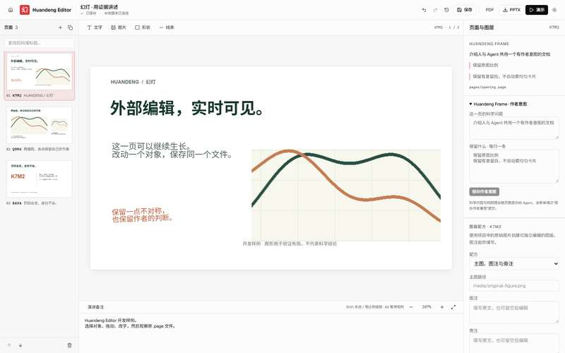

# Huandeng Editor · v0.1 实施记录

更新：2026-11-07。工程位置：D:\_Proj\Huandeng。分支：huandeng/pptd。

本记录描述实际代码和验证结果，产品合同保留在 [SPEC.md](SPEC.md)。本次交付是可以运行、原位编辑和导出的本地开发版本。

## 名称与基础

| 名称 | 当前职责 |
| --- | --- |
| Huandeng Editor · 幻灯编辑器 | PPTD 可视化编辑、演示、历史与导出 |
| Huandeng Story | 每页科学问题、保留的构图理由、对象角色和来源上下文 |
| Huandeng Plugin | 与编辑器共用写服务的 CLI / MCP 接口 |

基础是 MIT 许可的 OpenSlide，固定于 commit 327dd09bcd530eb97647fc33fa67e99f8137d860；上游 core 版本 2.3.1。保留上游包名、许可和原生 TSX 模式。产品名称已用于界面、启动入口、文档和插件目录。既有外部 fss_* 协议名保留兼容。

文档内容以 deck.pptd、独立 .page 和原素材为权威，React 负责显示。没有把生成的 TSX 当作第二份可编辑主源。

## 使用

在 Windows 双击仓库根目录的 Start-Huandeng.cmd，默认打开三页合成开发样例：

    http://127.0.0.1:4850/huandeng

新机器首次安装和构建：

    corepack pnpm install --frozen-lockfile
    corepack pnpm --filter @open-slide/core build

打开自己的文档：

    node packages/core/huandeng.js open "D:/MyProject/Slides/deck.pptd"

只读打开或只读解析：

    node packages/core/huandeng.js open "D:/MyProject/Slides/deck.pptd" --read-only
    node packages/core/huandeng.js check "D:/MyProject/Slides/deck.pptd"

可写打开会在缺失时初始化 .huandeng/project.json，持久化 deck/page UUID 与短码；仅打开不会重写既有页面。只读模式不生成身份文件。

样例 K7M2、Q9R4、B6XA 是页面短码。缩略图栏可搜索短码或标题；改变标题、页序不改变身份。复制页得到新身份，删除页保留 tombstone 和可恢复源文件。

## 已接通的工作流

| 部分 | 实际行为 |
| --- | --- |
| 自由编辑 | 文本、图片、基本形状和线条；拖动、缩放、旋转、图层、多选、对齐、基础富文本与图片裁切 |
| 页面操作 | 新增、复制、移动、移除、恢复；备注按稳定页面身份保存 |
| 保存 | 自动保存与显式保存；只修改涉及的源文件，保留未知字段、注释及未改字节 |
| 并行协作 | 页面、manifest 和 metadata 分别检查读取时版本；不同页面独立提交；同页过期写入被拒绝 |
| 请求重试 | 同 requestId 和同内容返回原回执；同 ID 换内容会被拒绝 |
| 实时更新 | GUI、Agent 和外部文件修改通过同一快照更新；外部变化不覆盖未保存草稿 |
| 图片更新 | 本地图片原路径替换改变 renderRevision 并刷新缓存，不必改写 .page |
| 撤销与恢复 | 操作级逆事务，只在所需版本仍匹配时撤销，保护较新修改 |
| 科研布局 | 图与图注、两组证据图、图与局部放大三个 recipe，结果保存为普通 PPTD 对象 |
| 人工调整 | recipe 保留手动几何、裁切和字体覆盖；已删槽位不复活；重置需显式操作 |
| 作者意图 | purpose / keep 表单与 Agent 上下文；保留对象角色、来源和原评审数据 |
| 演示 | 稳定身份导航；可切换演讲备注与下一页预览，默认观众画面不显示备注 |
| 导出 | 固定已提交快照的 PNG / PDF / 基础可编辑 PPTX，附对象级输出说明 |

GUI、CLI 与 MCP 调用同一个本地 writer。PPTD 模式停用上游 TSX 的写入接口和项目内会话文件；原生 TSX 模式继续由原 OpenSlide 入口提供。CLI/MCP 不另外启动独立的可写后端。桌面应用数据目录保存操作记录、幂等回执和恢复日志；普通保存不复制一整套活动 deck。

writer 使用本机互斥租约、原始字节哈希、恢复 journal 与文件替换。恢复前核对记录完整性；若文件已变成第三方新内容则停止覆盖。这负责本机协作，不把 OneDrive 或直接写文件的任意外部程序当作分布式事务系统。

## Git 检查点

普通保存不依赖 Git。明确调用以下命令才生成本地提交：

    node packages/core/huandeng.js --entry "D:/MyProject/Slides/deck.pptd" checkpoint "调整 K7M2 图注"

打开文档前记录 clean baseline 与 HEAD；只累计本轮成功事务的精确路径和 SHA256。提交前重查 HEAD、分支、暂存区、其他改动及源文件字节。外部内容进入本轮后，检查点暂停，避免把它混入应用修改。

既有 dirty 工作、其他工具暂存或 HEAD 变化会返回 deferred 并说明原因。启用签名或 commit hooks 时交由正常 Git 流程处理。暂存后才发生并发冲突会返回 staged:true，保留现状供检查。不会 stash、reset、自动 push，也不会回滚已保存的文档。

新素材通过外部方式加入时，需要普通 Git 流程一并审阅；不会因路径相邻而自动获得提交资格。

## Agent 入口

配置见 [mcp.example.json](../plugins/huandeng/mcp.example.json)。支持 stdio MCP 的客户端把 entry 指向已经运行的文档。当前八个工具：

- huandeng_context
- huandeng_page_read
- huandeng_selection_read
- huandeng_apply
- huandeng_render
- huandeng_history
- huandeng_revert
- huandeng_export

网页端可经已授权的工作站连接调用相同 CLI。本次没有安装云端 ChatGPT connector，也不要求公开本地服务。

Agent 编辑规则：先读 ID、版本、purpose / keep 和来源；只提交所需对象操作；冲突后重新读取；修改后检查渲染与导出说明。科学数据、来源和作者批准不能由布局工具编造。

## 实际验证

机器记录见 [evidence](evidence/)。临时用户名和随机目录已从可提交记录中移除。

### Windows 编辑闭环

在用户的 Windows 工作站，以已安装的 Edge 运行真实 React 界面，使用合成 fixture 的临时副本。

已验证：Agent 仅修改目标页并即时更新 GUI；幂等重试、同页过期拒绝及不同页独立提交；GUI 改字、拖动、保存和重载；移动页面保持身份和页面字节并可撤销；外部 YAML 与同路径图片更新；官方 MCP 客户端连接八个工具并通过现有 writer 修改；PNG、PDF、PPTX 导出不改源；非同源写入与越界资源被拒绝。

最终 14 项 Windows 端到端检查全部通过，包括演讲者备注身份绑定和 Git 检查点；浏览器脚本错误为 0。记录见 evidence/integration-windows.json。

原生 OpenSlide TSX fixture 也在 Edge 打开成功：1920×1080 画布，无页面脚本错误。

复跑入口：

    node scripts/verify-huandeng.mjs
    node scripts/verify-native.mjs

### Microsoft PowerPoint 实际打开

三页 PPTX 已由 Windows 上安装的 Microsoft PowerPoint 只读打开。页面尺寸 960×540 pt；首张含 6 个对象，其中 5 个文本对象可由 PowerPoint 对象模型读取，另一个为原图。标题 43 pt、副标题 22 pt、注释 19 pt。

也导出了 PowerPoint 自己渲染的首张图片，与编辑器截图进行视觉检查；位置、原图和中文文本一致。这覆盖基础 fixture，不表示任意复杂 PPTD 都已完成原生转换。

### 现有科研主文档

80 页主文档只读解析成功；尺寸 960×540，识别 974 个文本、174 个形状、262 张图片、39 条线及 2 个表格。读取前后 81 个源文件哈希一致，身份文件的有无不变。

这证明真实文件可解析且读取无写入，不代表 80 页所有复杂对象已逐页视觉验收。科研内容没有复制进仓库。

### 工程检查

Linux 全部 47 个测试文件、607 项测试通过，core 类型检查和构建通过；Biome 通过，只有上游模板的 5 个未解析软链接警告。Git helper 的 20 项临时仓库测试覆盖精确提交、CRLF、HEAD 变化、已有暂存、外部改动及 hooks/签名。Windows Git 测试使用 30 秒单项时限以覆盖真实进程启动开销，行为断言不变。Windows 针对新增功能的 84 项测试中，83 项通过、1 项 Unix 执行权限专用测试按平台跳过；Windows 类型、构建和 Biome 检查均通过。仓库用 .gitattributes 固定 LF 文本换行。最终机器记录见 evidence。

## 当前边界

- 普通文本、图片、基本形状和线条是 v0.1 的主要编辑范围；完整复杂图表、公式、表格、高级形状与注册 React 科学组件仍属后续增量。
- 任意 React / TSX 不与 PPTD 双向可逆；两个编辑模式各有明确的权威源。
- PPTX 为支持对象生成原生对象，其他可靠内容按对象回退；没有可靠呈现则明确报错。PNG 诊断预览若含不支持内容，报告 complete:false。
- 字体和浏览器排版可能与 PowerPoint 存在差异；没有全功能 PPTX 回导承诺。
- 本地素材参与 renderRevision；远端 URL 和机器字体环境尚未建立完整动态指纹。
- 原始评审记录保持原样。只读 authorReview 上下文通过精确 renderRevision 匹配派生 current / stale / unverified，approvalVerified 固定 false。版本匹配不等于认证作者身份。共享 metadata.patch 不能写入或删除 lastAuthorReview。
- “有人味”落实为自由排版、保留理由、手动覆盖与真实来源，没有虚构审美总分或自动等宽化所有页面。
- 当前是本地开发交付，没有发布 npm 包、推送公共仓库或生成签名桌面安装程序。

## 工程接续

- [README.md](../README.md)：启动和日常用法。
- [SPEC.md](SPEC.md)：产品合同。
- [WEBCHAT.md](../WEBCHAT.md)：后续 Agent 接续上下文。
- packages/core/src/pptd：存储、身份、命令、CLI/MCP、recipe、导出、Git。
- packages/core/src/app/components/pptd：渲染、画布、Inspector、缩略图、recipe、Story。
- packages/core/src/vite/routes/pptd.ts：本地服务与文件更新。
- tests/fixtures/studio：三页合成开发文档。
- docs/evidence：本次实际验证记录。

已有 Slidit、旧 FSS 工程及其未提交修改没有被覆盖。后续继续沿 Huandeng 的共同文档写入链路增加功能。
