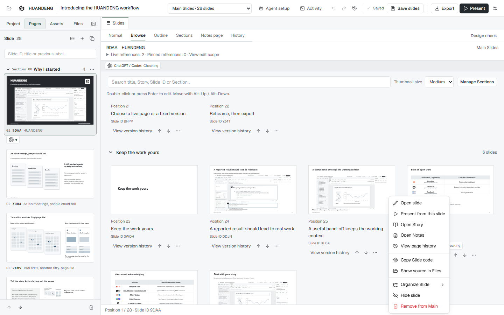
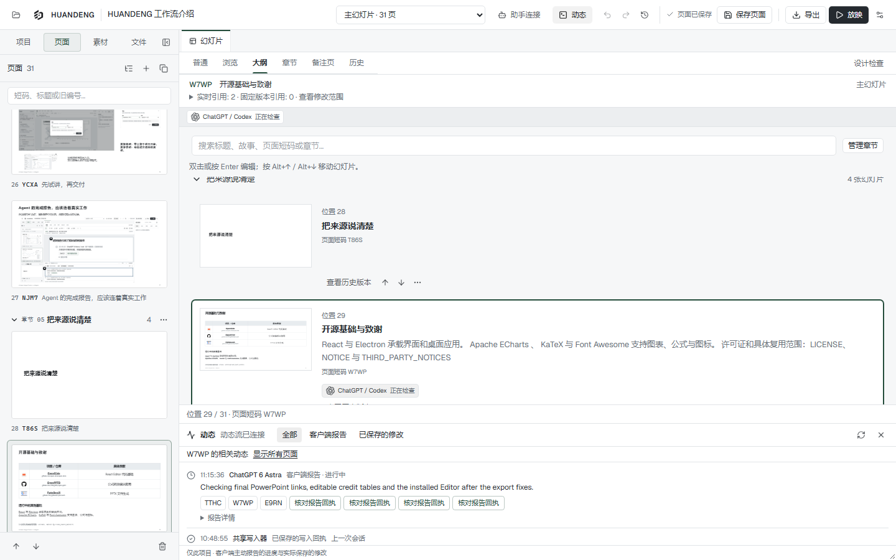

# HUANDENG Editor 0.21.0 candidate

This local candidate makes page operations easier to reach and shows which assistants have reported work on each page. It also completes native reference-link export and makes the native DeepSeek plugin the normal setup route. The introduction's accepted narrative and visual structure remain frozen; the example changes are limited to missing identity marks and reference destinations.

## Page actions in Browse and Outline

Right-click a page, use its More actions button, or press Shift+F10 while it has focus. Open it, present from that appearance, inspect Story, Notes or History, copy its Slide code, and find the source in Files. Main pages also offer insert-before/after, duplicate, move, hide/show and Remove from Main. Presentation actions locate Main or open the Presentation arrangement; fixed versions remain read-only.

The menu carries the actual page and occurrence it was opened on. Presenting another occurrence no longer depends on a previous selection. Existing draft, composition and read-only protections remain. Outline keeps actions next to the page information, omits a summary that merely repeats the title, and excludes explicitly marked watermarks from its body-text fallback.

## Reported agent work

Page badges show recent reports from ChatGPT / Codex, Claude / Claude Code and DeepSeek Harness. They show the reported stage and time and open the relevant Activity details. Several tasks can appear on one page without locking it. Reserved identities for pi, Zcode / GLM, WorkBuddy, Grokbot / Grok, Gemini, Antigravity and Hermes are labelled as future integrations.

Reports become stale after five minutes without an update, and stale page badges disappear after thirty minutes. Completed, failed and cancelled badges remain for two minutes; their records remain in Activity. Reports from an earlier writer session are stale. A save receipt is associated only when its actual operation ID and page match; it does not automatically complete a reported task.

CLI and MCP retain the existing 24-tool surface. Progress reports can include assistant family, workflow stage and explicit page scope. An older compatible writer receives the legacy report shape and the response identifies unsupported optional fields. Shared guidance asks agents to report real stage changes and terminal outcomes; an unattended heartbeat must not make stopped work appear active.

## Connection workflow and reference links

Agent setup offers the native DeepSeek Harness bundle first. Its generated configuration targets the installed `huandeng` plugin entry. The separately labelled legacy patch remains available for profiles without that bundle; the two routes must not be enabled together. Account and model settings are preserved.

Rich-text and native table-cell links retain supported text formatting and real destinations in PPTX. Their relationships are allocated against the final slide, alongside images, charts and Notes. PDF retains real link annotations. Unsafe schemes, credential-bearing URLs and malformed or obscured destinations do not become external actions. Editing a linked label still keeps the user in the document.

Credits use independently acquired marks from each author's own sources. The new [ChatGPT source record](../examples/huandeng-introduction/chatgpt-en/sources/identity-20261112/acquisition.json) includes HUANDENG's canonical icon and official project/product marks. GitHub is explicitly a repository marker where a project has no verified logo. Title-only Section pages remain outside this touch-up scope.

## Versions and local deployment

| Component | Candidate |
| --- | --- |
| Editor and plugin manifests | `0.21.0` |
| Windows desktop | `dist/HUANDENG-v0.21.0-win32-x64` |
| Portable Claude Code/Codex plugin | `dist/plugin-packages/0.21.0/portable-claude-codex/huandeng` |
| Native DeepSeek plugin | `dist/plugin-packages/0.21.0/deepseek-native/huandeng` |
| Core npm package | `2.3.1`, with the pending [minor Changeset](../.changeset/page-work-and-context-actions.md) |

The previous desktop exited through its normal close/save flow. The new executable is installed and running, with the PPTD file association and desktop/Start Menu shortcuts registered by `Install-Huandeng.ps1`. `Open-Huandeng.ps1` now prefers the versioned directory matching `release.json`, preventing an older unversioned package from taking precedence.

All six introduction projects have been reopened through that launcher. Their canonical writers have new process/session identities and advertise the new family/stage report capability. Existing recent-project preferences were preserved.

## Completed engineering verification

Core TypeScript, the production core build and repository-wide `pnpm check` passed. Both plugin layouts and the Windows desktop package were built, and their packaging/self-containment checks passed.

Focused unit and real-browser checks cover exact menu targets and Presentation occurrences, keyboard use, read-only behavior, report scope and expiry, old-writer compatibility, exact receipt matching, shared Activity subscriptions, and the native/legacy DeepSeek setup routes. The desktop configuration tests exercised the actual generators in an isolated installation fixture.

The installed final package also passed English and Chinese production-window checks: right-clicking B while A remained selected launched B, the page badge opened its filtered Activity, and an 820-pixel window had no horizontal card overflow. The checks made no document writes. After the final normal-close upgrade, all eight open projects, all eleven recent projects and the active project were preserved.

The link work passed 70 unit tests, including existing text/scientific export regressions, and two Chromium tests. These inspect native table/text hyperlink relationships, ID collisions with charts/images/Notes, rejected URLs, unchanged editing navigation, and actual PDF link annotations.

## Final example delivery

The six Main example decks and the affected existing Presentations were exported from the installed 0.21 Editor: 11 PDFs and 11 PPTX files. This includes the two ChatGPT short introductions, the two existing Claude Full presentations and the affected DeepSeek Chinese brief. Unchanged short presentations and historical exports were retained.

PDF URI annotations and native PowerPoint hyperlink destinations were checked against the saved sources. All 11 final PPTX files opened read-only in real PowerPoint with repair disabled, covering 263 slides without modifying the files. The PowerPoint object model confirmed editable native tables and actual hyperlinks; each ChatGPT foundation table has all eight source links. The changed pages were visually reviewed in PowerPoint, including the cover links, table rows, Claude's green links and DeepSeek's original colors.

This review caught and fixed two export defects: normal-weight URL spans had caused an entire credit table to fall back to an image, and the PowerPoint theme had overridden authored hyperlink colors. Native export now supports normal/bold inline weights and uses the documented [Office hyperlink-color extension](https://learn.microsoft.com/en-us/openspecs/office_standards/ms-odrawxml/3c384794-9e01-480a-accf-8dfb4d99d645) to retain the text color. That color extension is available in Office 2019 and later; older viewers can apply their theme colors.

The six speaker-notes files were synchronized from saved Main and formally resolved Presentation Notes, preserving the approved narration. The two ChatGPT overview images now show the finished reference pages. Original founder stories, all six sequences and Presentation compositions, and all 22 title-only Section pages were preserved. The author's concurrent local page adjustment was retained.

This candidate has not been published as a public release or to npm. The Editor milestone leaves the inherited npm version and unrelated pending Changesets unconsumed.
