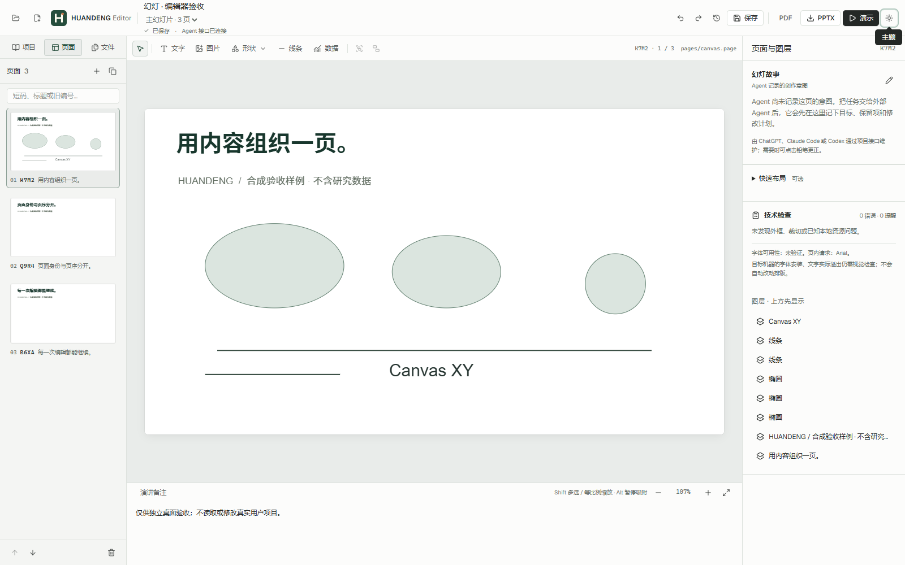

# HUANDENG Editor v0.5 — 日常编辑体验

更新日期：2026-11-07（UTC）。**HUANDENG Editor v0.5 已安装到既有正式位置，常规用户 profile 已打开原 80 页项目，窗口可响应、项目可写、没有诊断错误，82 份文档源文件 hash 保持不变。** 运行时 `03a96957` 的正式程序包已通过桌面、编辑器、保存恢复，以及 5 轮可比性能与独立 20 轮连续操作验收。发行标识为 `editor-v0.5.0`。

本版从 [Issue #6](https://github.com/JaytonKogeru/huandeng/issues/6) 和历次 SPEC / Audit / Handoff 的 [综合产品审计](AUDIT-V05-COVERAGE.md) 出发，优先改善打开大项目、反复增删对象、画布放置、页面定位和界面一致性；连续编辑验收中发现的 Windows 保存恢复问题也一并修复。

## 当前交付与来源

| 字段 | 实际结果 |
| --- | --- |
| 产品版本 | `0.5.0` |
| 运行时提交 | `03a96957f854ab593400218102928d1feb3c86d0` |
| 构建时间 | `2026-11-07T13:26:12.5660629Z` |
| 构建来源 | `sourceDirty=false`；隔离 worktree 打包 exit 0 |
| 自包含与搬迁 | 两次检查通过 |
| 实际 EXE | Desktop 7/7、Editor 8/8、真实文件锁恢复 6/6；全部进程 exit 0 |
| 大项目连续操作 | 同一 80 页材料，独立 5 轮与 20 轮运行均完成，无 renderer error 或 transaction failure |
| 正式安装 | 既有 `dist/HUANDENG-win32-x64` 位置；保留 v0.4 备份，旧窗口正常退出，无强杀 |
| 快捷方式 | 桌面与开始菜单两项的目标、工作目录、图标均校验正确；图标 hash 与源码一致 |
| About | 实际菜单 handler 捕获的版本消息为 `HUANDENG Editor 0.5.0` |
| 用户当前窗口 | 常规 profile 打开原 80 页项目，static 服务、可写、无诊断、源文件不变；窗口保留供使用 |
| 发行标识 | `editor-v0.5.0`；远端分支与标签同步由发布步骤独立核对 |

构建、实际 EXE、性能与安装分别记录。完整工程来源见 [HANDOFF-V05](HANDOFF-V05.md)，各阶段原始回执的安全摘要见 [证据索引](evidence/ui-v05/README.md)。

[安装验收](evidence/ui-v05/installation-acceptance.json)同时覆盖正式路径上的三页合成项目启动、零 renderer error、About 的真实菜单处理函数，以及随后常规 profile 的实际项目启动和原生窗口检查。About 证据是对话框调用的版本消息捕获，不是原生对话框截图。安装过程保留了原有用户修改的 fixture；旧版备份位置见 Handoff。

## 正式程序包的性能结果

同一台 Windows 机器、同一 80 页项目的隔离临时副本、全新 Electron 进程及独立 profile/runtime，窗口内容区 1600×1000、DPR 1。Electron 38.7.2、Node 22.21.0。旧版使用已安装的 v0.4 EXE，新版使用上述 `03a96957` 正式 EXE。

**操作系统文件缓存未清空。** 这些结果描述本机已经可读取的项目副本，不证明 OneDrive 尚未驻留文件的下载或冷启动性能。两次旧版基线都保留，不只选择较慢的一次比较。下表新旧操作计时均为各自 5 个样本；[正式包性能摘要](evidence/ui-v05/performance-packaged.json) 保存完整计数、范围、来源和原回执 SHA-256。

| 指标 | v0.4 第一次 | v0.4 第二次 | v0.5 正式包 |
| --- | ---: | ---: | ---: |
| 启动到首次可编辑画布 | 27,318.85 ms | 24,124.15 ms | **5,981.30 ms** |
| 初始完整缩略图 renderer | 80 | 80 | **7** |
| 初始 DOM 节点 | 8,962 | 8,962 | **1,734** |
| Delete 视觉反馈中位数 | 2,388.4 ms | 2,393.6 ms | **27.4 ms** |
| Delete 视觉反馈范围 | 2,351.3–3,697.1 ms | 2,345.1–2,433.7 ms | **24.2–34.3 ms** |
| Delete 落盘观测中位数 | 930.7 ms | 921.9 ms | **222.5 ms** |
| Delete 落盘观测范围 | 924.5–1,123.5 ms | 901.4–944.2 ms | **209.0–316.3 ms** |
| Delete 服务确认中位数 | 2,982.7 ms | 2,922.4 ms | **508.5 ms** |

视觉反馈由 renderer 的 keydown 到 MutationObserver 看到对象移除计量；落盘由 10 ms 文件轮询观测，服务确认另行计时。画布立即响应以后，保存仍要经过真实事务和快照确认；27.4 ms 不代表文件在同一时刻已经保存。

### 20 轮连续操作与内存

另一次全新进程运行完成 **20 轮插入/删除**。首次可编辑为 5,942.02 ms；20 次 Delete 的视觉范围为 **19.2–30.5 ms**，落盘范围为 **178.8–259.5 ms**，服务确认范围为 **452.4–527.5 ms**。初末 DOM 都为 1,734 个，80 条缩略图导航保留、实际完整 renderer 为 7 个。两次正式运行均正常关闭；各自检查的 82 份 manifest、页面和 metadata 原文件 hash 不变，错误列表为空。

| 进程工作集采样 | v0.4 第二次基线 | v0.5 正式包 5 轮 | v0.5 独立 20 轮 |
| --- | ---: | ---: | ---: |
| 启动后空闲 renderer | 561.5 MiB | 172.5 MiB | 165.4 MiB |
| 操作后 renderer | 1,022.9 MiB | 307.4 MiB | 407.9 MiB |
| 启动后空闲文档服务 | 1,021.3 MiB | 210.1 MiB | 201.6 MiB |
| 操作后文档服务 | 1,113.4 MiB | 212.3 MiB | 265.5 MiB |

工作集是对应时点的进程采样，不是全部应用进程之和，也不是存活堆对象大小。本轮明显降低了启动和同样 5 轮操作后的占用；20 轮后仍有增长，因此长期会话的内存分析仍是后续工作，不能宣布内存问题已经彻底消失。20 样本原脚本使用上中位值；原 JSON 保持原样，安全摘要另外给出按中间两值平均计算的常规中位数，本文持续操作仅列范围。

## 用户可见的变化

| 领域 | v0.5 行为 |
| --- | --- |
| 打开大项目 | 直接加载构建好的正式前端；缩略图只挂载可见区域和邻近页面，保留全部导航入口 |
| 日常增删 | 安全的新增/删除立即反映到画布；未变页面和元数据复用引用，草稿投影缓存，重复刷新合并 |
| 插入工具 | 先选文字、形状或线条，再点击或拖拽放置；支持反向拖动、Shift 约束、Esc 取消，以及 V/T/R/L 快捷键 |
| 文字输入 | 放置后自动进入文字编辑；Backspace 删除文字，退出编辑后 Delete 才按对象操作 |
| 页面定位 | 四位随机短码优先显示，当前页序单独显示；可按标题、短码和旧 S 别名搜索，右键复制短码 |
| 界面组织 | 主幻灯片、演讲幻灯片、项目与故事、快速布局统一术语；科研对象归入“数据”，图表按子菜单组织 |
| 视觉与反馈 | 统一绿 H 标识、字阶、工具选中和焦点；增加短促悬停/按压/菜单反馈，尊重系统减少动态效果偏好；重整近期项目首页 |
| 未完成保存 | 明确显示“保存待恢复”，提供当前窗口内的恢复动作和待保存页面复制入口；恢复后继续保存输入并正常关闭 |

性能变化来自减少重复渲染、重复解析和素材指纹工作，并提前构建前端。PPTD manifest、独立 `.page` 和本地素材继续为权威内容；没有另建保存格式或迁移桌面框架。Main / Presentation / Story、命名页面版本、科学对象和原生/回退导出继续使用现有模型。页面 UUID、旧 S 别名和文件结构保持兼容。

快速布局继续是可选辅助，结果为普通对象，尊重手工修改并可解除关联。本轮改善编辑工具的层级、反馈和密度，没有扩大固定模板库，也没有把自动装饰当作“去 AI 感”。设计判断见 [视觉审计](AUDIT-V05-VISUAL.md) 和 [综合审计](AUDIT-V05-COVERAGE.md)。

以下是 `03a96957` 正式 EXE 的实际界面，使用独立合成项目；[紧凑窗口](evidence/ui-v05/editor-compact.png) 与 [深色模式](evidence/ui-v05/editor-dark.png)也已逐张核查。紧凑窗口的 1024×768 验收仅在隔离实例降低最小窗口限制。

## 保存可靠性与实际故障修复

首次打包候选 `80a83ee` 在第三轮删除时遇到 Windows `EPERM` 原子替换失败，保留了 pending journal。原有关闭保护与“重新打开”提示形成操作死锁，因此该候选没有安装或发布。失败现场和旧回执保留，不能改写为通过。

本版对暂时文件占用执行有界重试；持续占用时保留 journal 和本地草稿，用户解除占用后点击“恢复未完成保存”。恢复使用原交易和原 requestId 确认 receipt，再重建发送后草稿的基线。恢复期间继续输入不会被丢弃，已取得 receipt 的操作不会重复提交；Undo/Redo 也保留原请求身份。

文件或保存记录与预期不一致时，恢复停止，外部内容和草稿保留，并显示明确原因。较弱的后台 pending 诊断不会覆盖该原因。恢复同时观察到其他页面、metadata 或 manifest 的外部更改时，仍按 external 事件处理，使 Git checkpoint 延后。

原失败 journal 已在原项目位置与 state directory 安全恢复：目标字节等于原 after，原请求三次返回同一 receipt，历史只有一条，另外 81 份文档文件 hash 不变。正式 EXE 的真实 Windows 文件共享故障验收 **6/6** 通过，覆盖短暂占用、长时间占用、恢复后继续输入、第三态拒绝、刷新后原因保持和正常关闭；四张新截图逐张核查，无 renderer/cleanup error。详见 [恢复审计](AUDIT-V05-RECOVERY.md) 与 [正式包恢复回执](evidence/ui-v05/recovery-packaged.json)。

## 验证范围

| 范围 | 结果 | 来源与边界 |
| --- | --- | --- |
| 最终源码门槛 | Linux 63 文件、800/800；Windows 63 文件、799 通过及 1 项 POSIX 专属跳过 | [代码摘要](evidence/ui-v05/code-validation-recovery-followup.json)；两端 core TypeScript/build 通过，Windows Biome 569 文件及 Linux 修改 6 文件通过 |
| 客户端保存契约 | 34/34 | 覆盖引用复用、刷新竞态、增删预览、发送后输入、receipt 恢复、第三态和外部草稿冲突 |
| 正式 EXE 桌面 | 7/7、exit 0、无 renderer error | [桌面回执](evidence/ui-v05/desktop-packaged-acceptance.json)：MCP、Story、历史、文件树、重启、新建/打开、近期项目 |
| 正式 EXE 编辑器 | 8/8、exit 0、无 renderer error | [编辑器回执](evidence/ui-v05/editor-packaged-acceptance.json)：放置/取消/约束、文字、真实文件撤销/重做、短码与剪贴板、三组窗口/主题布局 |
| 正式 EXE 恢复 | 6/6、exit 0；四图核查通过 | [恢复回执](evidence/ui-v05/recovery-packaged.json)：真实 Windows 句柄和原 receipt 链路，全部使用合成项目 |
| 正式 EXE 大项目 | 5 轮可比与独立 20 轮均通过 | [性能回执](evidence/ui-v05/performance-packaged.json)：82 份文档输入不变，零 renderer/transaction failure |
| 正式路径安装与常规启动 | 快捷方式、图标、版本、static 运行通过；原 80 页项目可写、无诊断，原生窗口存在且可响应 | [安装回执](evidence/ui-v05/installation-acceptance.json)：正常退出旧窗口，保留旧版备份与用户 fixture，82 份文档输入不变 |
| 项目编排 | 第二轮 11/11 | [项目回执](evidence/ui-v05/project-phase2-acceptance.json)：章节/演讲、重复/固定引用、备注与冲突草稿；保持该轮来源 |
| 科学对象与背景/PDF | 首轮 Science 22/22；当前/固定版本背景回归通过 | [科学对象](evidence/ui-v05/science-acceptance.json)、[背景/PDF](evidence/ui-v05/background-export-acceptance.json)：2 occurrence、2 背景栅格、8 前景栅格、2 物理 PDF 页 |
| 真实科研项目与 Office | 80 页/1,452 内容对象，7 组通过；970 份读入源文件不变 | [真实项目](evidence/ui-v05/real-project-acceptance.json)、[真实 Office](evidence/ui-v05/real-office-acceptance.json)；导出核心与前端保留首轮来源 |
| 原生 Office 对象 | 5 页、6 原生图表、1 表格、1 组合、5 数学对象 | [原生 Office](evidence/ui-v05/native-office-acceptance.json)：表格/图表实际编辑后重开，组合/数学保留；首轮核心 |

80 页 Office 全部渲染，未启用修复；78 张 PNG 与已验收 v0.4 输出字节一致。两张差异页面已核查：一页保留本轮开始前原稿已有的矩形，另一页只有 6,444 / 1,440,000 像素、最大 RGB 通道差 3 的边缘抗锯齿差异。原自动回执的待人工字段没有被覆盖，后续人工结论独立记录。

早期候选 774/796 项代码门槛、首轮性能、开发宿主恢复和首包失败都在 [证据索引](evidence/ui-v05/README.md) 保留。项目/科学对象/Office 的旧批次不会改名为“最终包全部重跑”。用户研究内容、原路径、原文件清单和截图不进入可提交摘要。

## 包体积和后续产品范围

正式安装目录的只读体积核查为 **683,064,563 B（651.42 MiB）**，29,113 文件、2,398 目录，无 symlink 或扫描错误，构建标记在扫描前后不变。旧版无缓存基线为 679,320,441 B（647.85 MiB），本版增加 3,744,122 B，约 **0.55%**。Electron/根资源为 339,741,935 B，其他 Node 依赖 331,160,250 B，core 11,720,219 B，桌面文件 442,159 B；详见 [最终体积摘要](evidence/ui-v05/package-footprint-final.json)。

本轮保留 Electron 与共享 Node 文档服务，没有进行框架迁移或宣称缩小安装包。[初始失败候选的体积](evidence/ui-v05/package-footprint-initial-candidate.json)仍独立保留。字节数为文件表观大小，不是 NTFS 分配/压缩大小或运行内存。

下一批优先级是：实际字体可用性与回退检查、可靠的文本/公式溢出诊断、长期会话内存分析。其后是素材重连向导、大库批量编排与独立双屏演讲。依赖精简须在确认真实用途后，覆盖导出与外部 Agent 的自包含性。完整 PPTX 往返、评论、母版/SmartArt 和媒体时间线仍属于独立产品范围，未在本版补齐。
