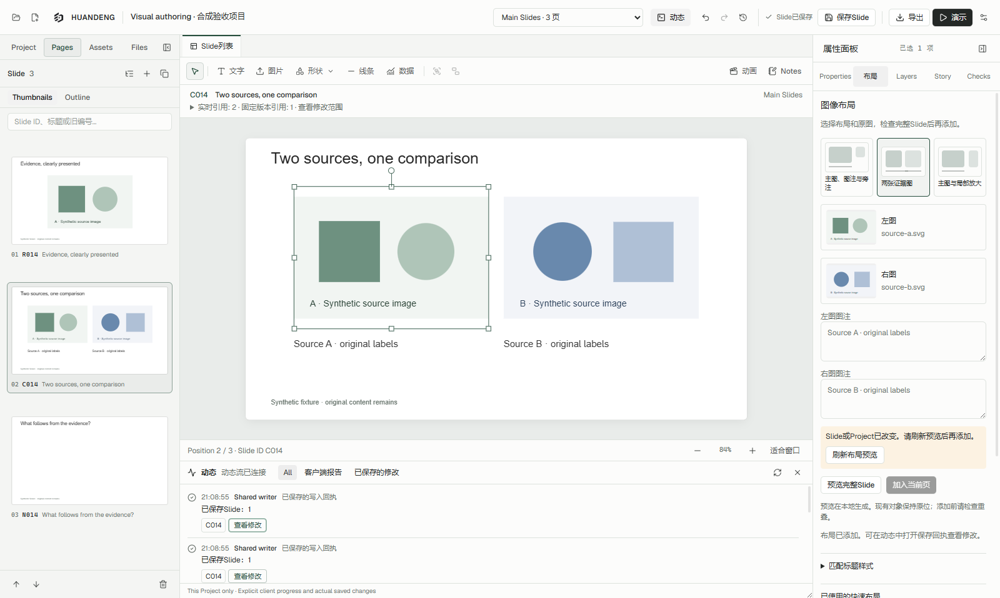
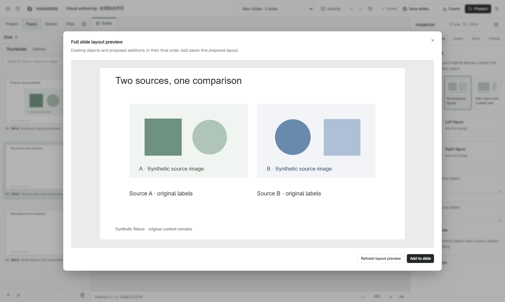
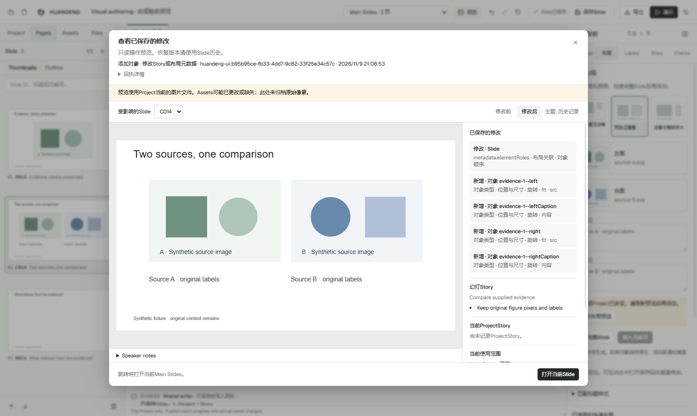
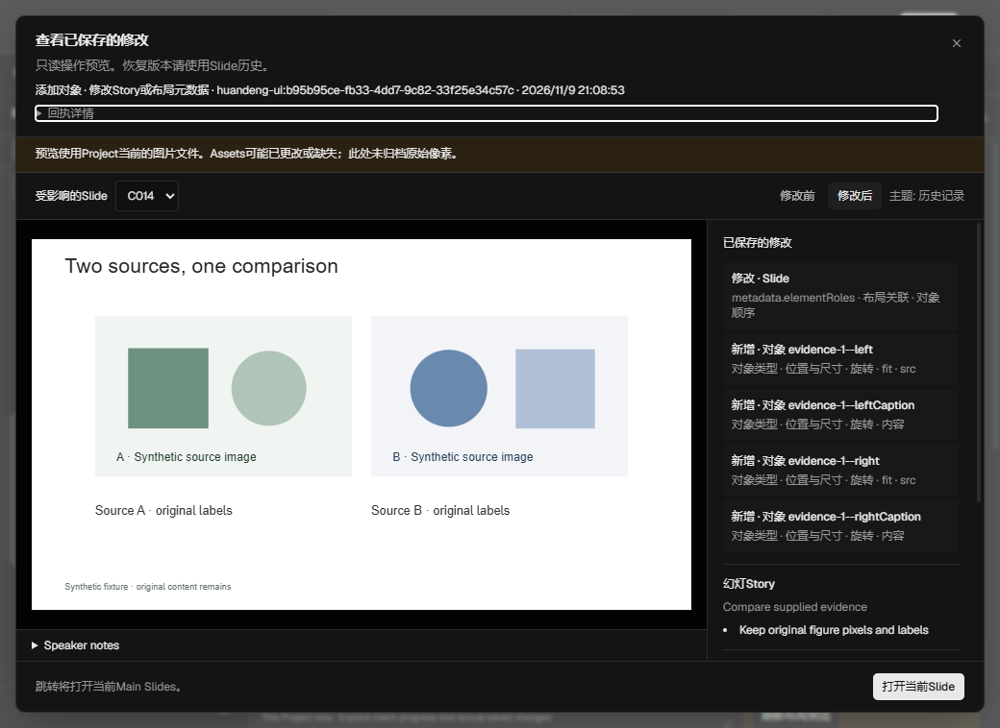
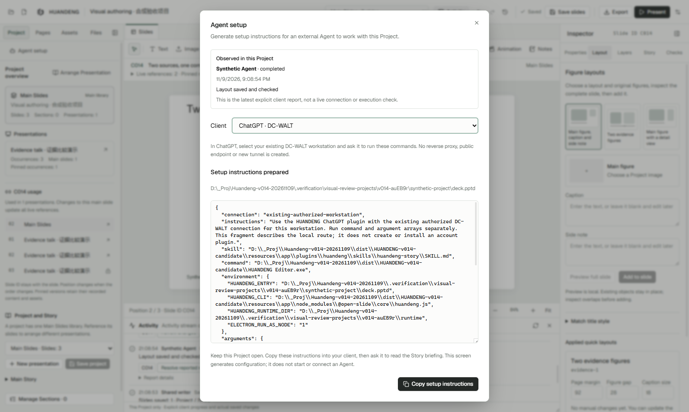

# HUANDENG 0.14 界面与操作流程

本轮把“看懂当前页面 → 组织图像 → 检查修改 → 回到编辑”接成了一条实际流程。以下均为最终安装包的合成项目截图，不包含研究数据。

## 整体界面

最外层标签切换 Project；左侧管理页面和资料；中间负责当前文档与画布；右侧按属性、布局、图层、Story、检查划分任务。Activity 可收起，审阅按需展开。

画布上方显示当前页编号、标题、主页面/实时引用/固定版本，以及真实引用数量。“查看修改范围”展开具体引用并可跳转；固定版本保留自己的历史画面。

## 从原图到布局

1. 选择页面，在右侧打开“布局”。
2. 从三种图像布局中选择一种，再用图片缩略图选择 Project 原图；可搜索和分页。
3. 填写图注，打开整页预览。已有标题、正文和其他对象一起显示；原图内部的像素和标注保持原样。
4. 确认画面后添加。保存的是这份预览对应的对象和位置。若页面、Project 或原图变化，界面要求刷新，防止保存过时结果。

新布局可根据显式标记的顶部标题预留空间。已有页面不会被自动重排；原有标题参考与绑定重置功能仍然可用。

## 从 Agent 报告到真实修改

Activity 将“客户端主动报告”和“编辑器保存回执”分开。客户端说已完成时，仍需通过明确的保存回执打开该次修改。

点击“审阅修改”后，可以切换修改前/后、选择受影响页面、点击变更对象查看高亮，并结合 Story、备注和引用范围判断结果。“打开当前对象/页面”返回可继续编辑的当前版本。

审阅窗口只读；恢复历史版本仍通过既有页面历史入口。历史图片预览使用当前 Project 图片文件，界面明确提示这一限制。需要保留历史原图时，使用命名版本。

## 小窗口、深色和连接状态

连接面板分别回答“配置是否生成”和“这个项目最近收到什么报告”。没有报告不代表配置失败；读取历史失败也不会显示成“从未收到报告”。报告不会被包装为实时连接或任务完成的证明。

## 本轮设计判断

视觉与功能的连接已经由文字说明推进到可操作的界面：布局缩略图对应具体生成结果，修改列表对应画布对象，范围提示对应真实引用，Agent 的完成声明对应可核验的保存回执。下一步最值得推进的是原始文献/图像来源关系、可继承母版和发布状态；本轮没有把它们伪装成已完成。
