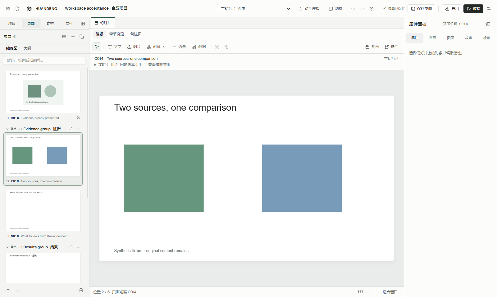
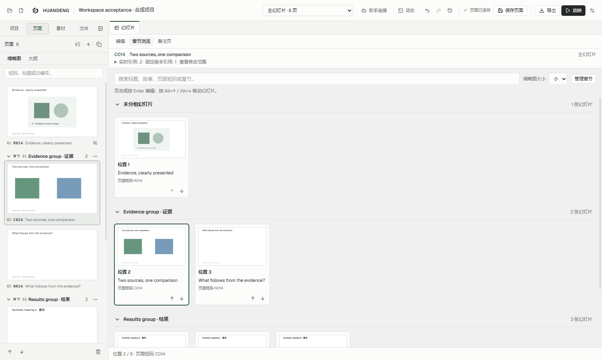
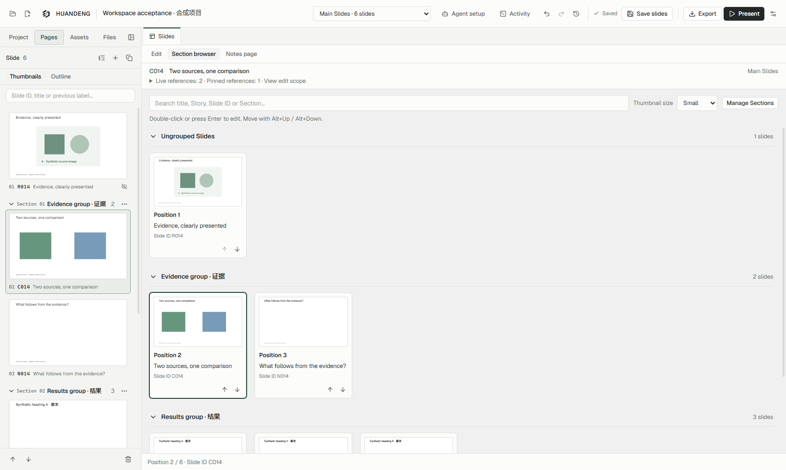
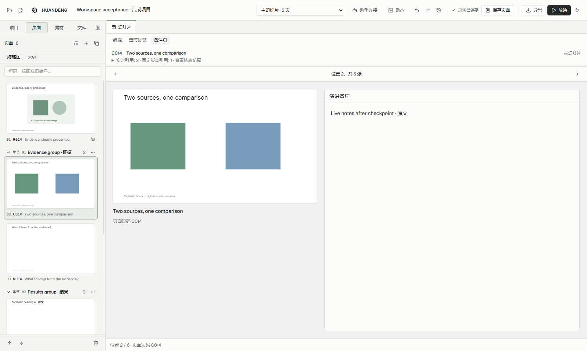
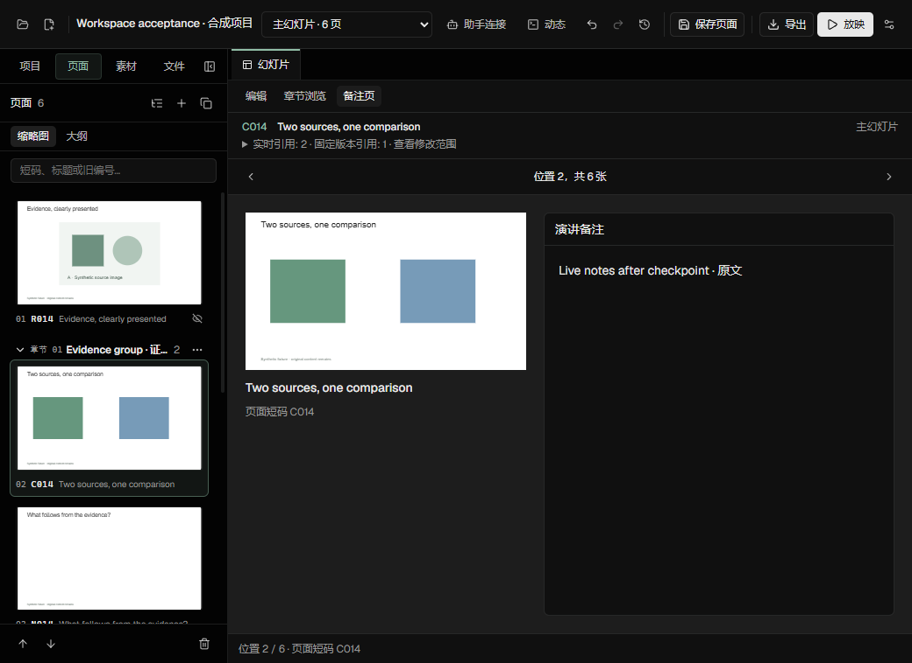
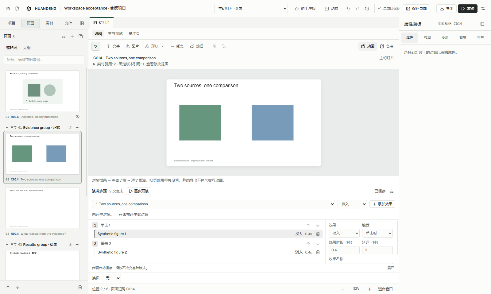
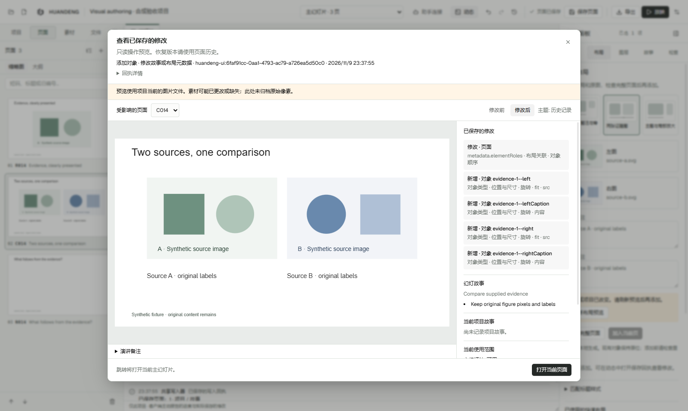

# HUANDENG 0.15 界面与操作流程

工作区围绕三个任务组织：编辑一页、检查整套内容、准备讲稿。助手连接和动态位于应用顶栏；幻灯片文档始终保留，打开的资料文件仍可关闭。

以下图片来自最终 0.15.0 安装包的合成验收项目，内容中的中英文是作者原文，用于验证切换界面语言不会改写内容。

## 编辑一页

在左侧缩略图或大纲定位页面，中央“编辑”显示画布和对象工具，右侧继续提供属性、布局、图层、故事和检查。缩略图间的空白收紧，页序与稳定页面短码分开显示。中文界面使用中文控件，作者撰写的英文内容保持英文。

原有布局和修改审阅仍在同一流程中：选择原图和布局 → 检查整页预览 → 保存该预览 → 从动态打开真实保存回执 → 查看前后画面、变更对象与引用范围 → 回到当前对象。没有另建一套保存或审阅入口。

## 章节浏览

点击中央的“章节浏览”，按章节查看实际幻灯片画面。标题行显示章节名称和页数；未分组页面有自己的区域。章节锚点只定义范围，不会被当成封面内容。

搜索可匹配标题、故事、短码和章节；缩略图大小可选小、中、大。单击选中，双击或 Enter 回到编辑。主序列使用卡片上下按钮或 Alt+↑ / Alt+↓ 调整顺序，仍经同一个保存服务。搜索中或章节折叠时停止重排，避免目标位置不明确。左侧原有拖动排序继续保留。

演讲集合按实际引用顺序浏览，同一页面的多次出现分别可选；固定版本保留历史画面和只读状态。浏览不会误改主序列顺序。离开浏览后，查询、折叠和缩略图大小回到默认；当前页面选择保留。

## 备注页

点击“备注页”，一侧显示当前页面，另一侧显示宽讲稿区。长备注独立滚动，上一页/下一页用于连续备讲。这里和编辑视图的小备注面板使用同一份草稿、输入法状态和保存路径。

主序列备注可直接编辑；演讲备注沿用出现项的编辑规则，固定版本只读。视图切换保持页面与引用身份，未完成的动画等辅助草稿仍会阻止可能丢失修改的切换。

## 动画与放映

在“编辑”中选择对象，再打开唯一的动画入口。对象效果、点击步骤和页面转场分区说明；先预演，再保存。原有高级关键帧继续可用。这里编辑的是演讲过程中逐次触发的动画。

顶栏“放映”菜单明确提供“从头放映”（F5）与“从当前页放映”（Shift+F5）。点击、空格或前进键推进步骤，Esc 退出并返回编辑。PNG/PDF/PPTX 当前仍只导出静态布局，不保留交互动画。

## 固定文档与助手

“幻灯片”是固定文档。Ctrl+W 在资料文件中关闭该文件并返回幻灯片；在幻灯片中保持当前文档。显式关闭项目和窗口仍可使用，并保留草稿保护。

“助手连接”移到顶栏，与“动态”相邻。连接配置、客户端报告、真实保存回执各有含义；生成配置不等于已连接，收到报告也不等于页面修改已经通过验收。

## 产品判断

HUANDENG 的可核查优势是稳定身份、引用范围、版本约束写入和真实修改审阅。良好的美术还需要作者认可的参考页、明确的版式选择、跨页节奏检查和实际渲染验收。本轮浏览视图与插件工作流加强了这一联系；尚无同题对照实验支持“整体优于 PowerPoint、Google Slides 或 Kimi”的结论。完整依据见 [Audit](AUDIT-V015.md)。
