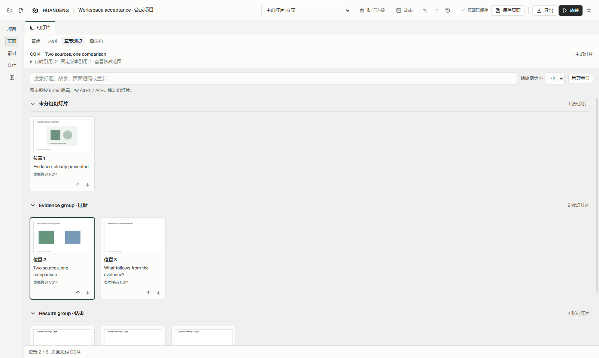
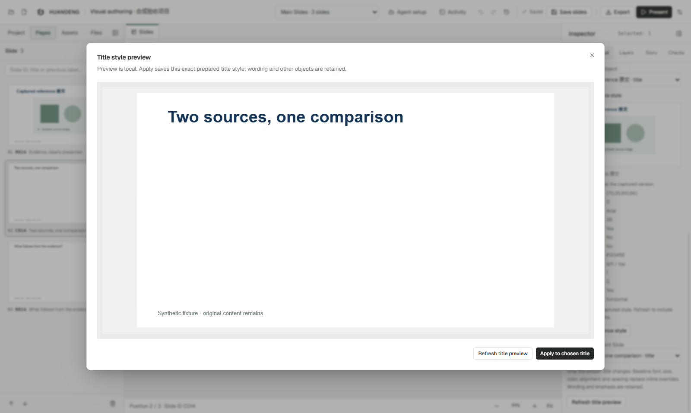

# HUANDENG 0.16 界面与操作流程

幻灯片工作区只有一组视图入口：**普通 / 大纲 / 章节浏览 / 备注页**。这组入口同时决定导航形式与中间工作区，替代原来分散在左侧和中间的两组切换按钮。

| 视图 | 左侧导航 | 中间工作区 | 适合做什么 |
| --- | --- | --- | --- |
| 普通 | 页面缩略图 | 可编辑画布 | 精修文字、图片和对象布局 |
| 大纲 | 按章节组织的标题与故事 | 可编辑画布 | 对照论述结构调整具体页面 |
| 章节浏览 | 收起重复的页面栏；保留项目、素材、文件入口 | 按章节排列的页面网格 | 看节奏、内容分布和整套视觉一致性 |
| 备注页 | 页面缩略图 | 页面预览与讲稿 | 整理讲述内容、排练 |

切换视图沿用当前页面与演示中的引用。主幻灯片顺序、页面身份和固定版本仍然分开处理。关闭文件预览会回到常驻的幻灯片文档。

其他实际界面：[普通](evidence/v016/edit-1600-zh-CN-light.png)、[大纲](evidence/v016/outline-1600-zh-CN-light.png)、[备注页](evidence/v016/notes-1600-zh-CN-light.png)、[窄窗口深色大纲](evidence/v016/outline-1040-zh-CN-dark.png)。截图使用合成验收项目，原文有意保留不同语言。

## 从视觉参考到可审阅的改动

1. 在普通或大纲视图选择目标标题，进入 **布局 → 匹配标题样式**。
2. 选择参考页和参考标题，检查捕获的位置、字体、字号、颜色与间距。参考页后来改变时，已捕获的样式会明确标记为旧参考，可手动重新捕获。
3. 打开完整目标页预览，连同原有文字、图片和背景检查结果。这个步骤不保存文件。
4. 应用预览中的同一组修改。预览后目标页、主题或相关上下文变化时，先重新预览。需要恢复时使用现有撤销。
5. 在 **动态** 中打开实际保存的修改记录，查看前后页面与变动对象；在 **检查** 中查看审阅记录是否仍匹配当前版本。

“版本匹配”只说明记录对应的版本，不能替代对内容、排版和导出结果的检查。演示中的引用顺序、讲稿和固定版本也有各自的检查范围。

未保存、等待保存确认或发生冲突的画面，会说明当前显示的修改不在已保存的审阅证据范围内。保存确认或放弃修改后，再显示相应的已保存版本状态。

[未保存画面的审阅提示](evidence/v016/review-projected-zh.png)与[已过期的审阅记录](evidence/v016/review-stale-zh.png)分别展示两种状态。

## 大文件浏览

章节浏览仍保留全部页面卡片、章节与操作位置。只有视口附近的卡片挂载完整页面渲染器，离开后释放，返回时按当前版本重新渲染。当前画布的原图请求优先处理，同时给缩略图保留进度。连续文档更新读取已经提交的状态；重新连接或发现事件缺口时执行完整刷新。

性能结果和机器负载条件见本轮验证记录。启动速度、图片解码和页面复杂度仍需分别评估。

## 插件与编辑器共用的工作方式

读取项目、故事与选中页面 → 检查参考和原始素材 → 提出有范围的修改 → 使用共享保存入口 → 查看实际修改记录 → 检查渲染结果 → 按需要排练或检查导出。

本轮把参考样式、目标预览和修改证据接了起来。完整设计约束提取、跨会话缩略图缓存、增量上下文传输和原生 PowerPoint 动画仍属于后续工作。
