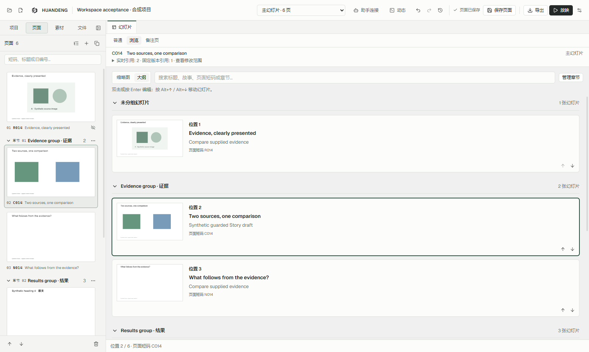

# HUANDENG 0.16.1：视图与导航各司其职

顶部保留 **普通 / 浏览 / 备注页**，只切换中央工作区。左侧导航由自己的按钮控制，选中的项目、页面、素材或文件标签，以及宽度和展开状态，不再随主视图改变。

| 入口 | 中央内容 | 用途 |
| --- | --- | --- |
| 普通 | 可编辑画布 | 调整页面上的文字、图形与布局 |
| 浏览 → 缩略图 | 按章节组织的预览网格 | 看整套视觉、页序和章节节奏 |
| 浏览 → 大纲 | 小预览、标题与页面摘要组成的列表 | 通读内容结构、发现缺页和重复论述 |
| 备注页 | 当前页预览与讲稿编辑区 | 整理具体讲述内容 |

大纲按钮与变化区域处于同一个浏览面板。摘要优先读取 Story 中的页面目的，否则读取页面正文摘录；不会用讲稿替代，也不修改作者的文字。没有摘要时明确显示空状态。

浏览的两种显示方式共用搜索、章节折叠、页面选择和排序规则。双击或按 Enter 回到该页的普通视图；选中页面后切到备注页，整理同一页的讲稿。经过普通或备注页再返回浏览，会保留刚才选择的缩略图/大纲显示方式。搜索和折叠状态在两种浏览显示之间共享，离开浏览再返回时仍按既有方式重新初始化。

左侧页面栏始终是缩略图导航；需要更大中央空间时可主动收起，其他视图也沿用这个选择。切换前仍须完成输入法组词或处理未保存的面板草稿。

其他实际截图：[普通](evidence/v0161/edit-1600-zh-CN-light.png)、[浏览缩略图](evidence/v0161/browse-1600-zh-CN-light.png)、[备注页](evidence/v0161/notes-1600-zh-CN-light.png)、[窄窗口深色大纲](evidence/v0161/outline-1040-zh-CN-dark.png)。均为合成验收项目，作者内容中的中英文有意保留。
