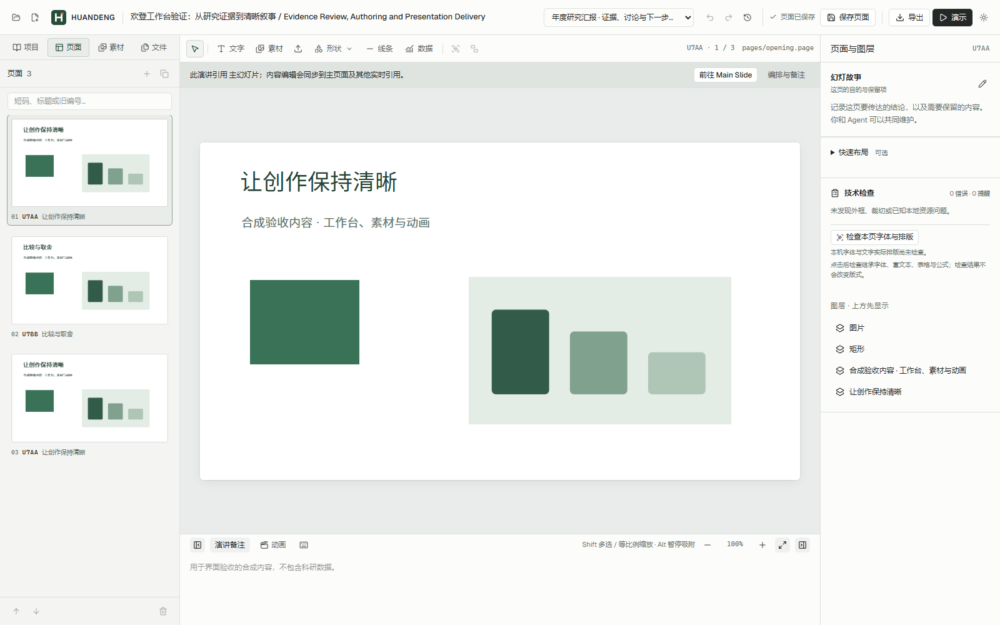
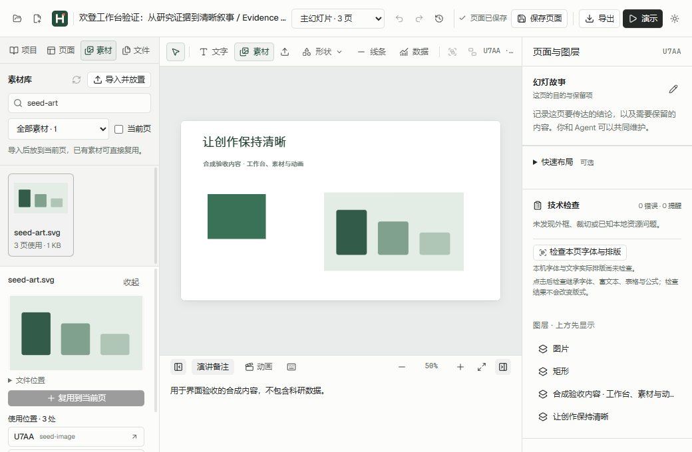
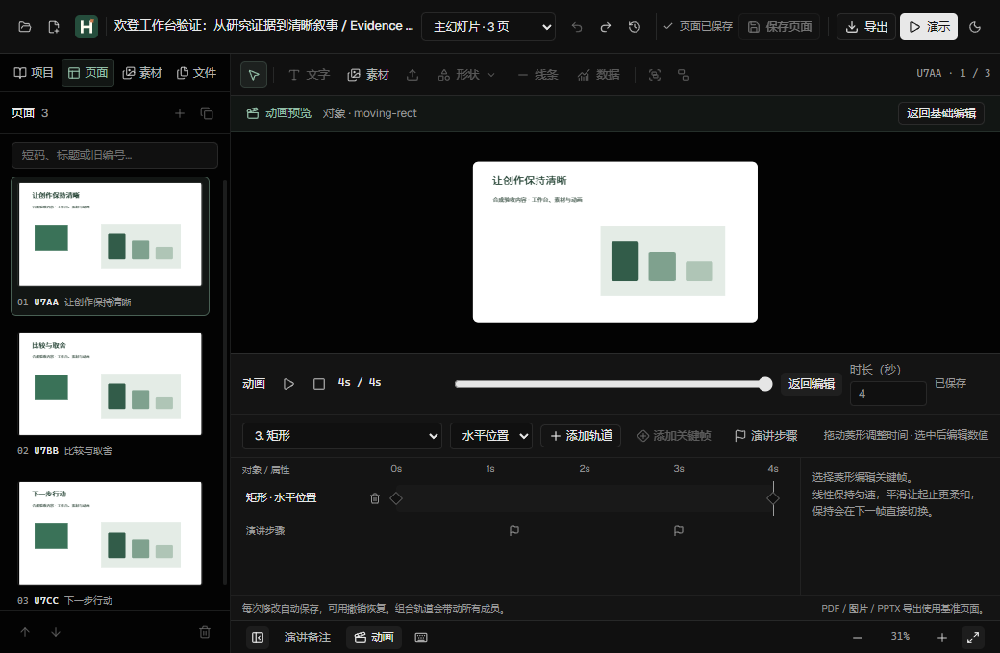
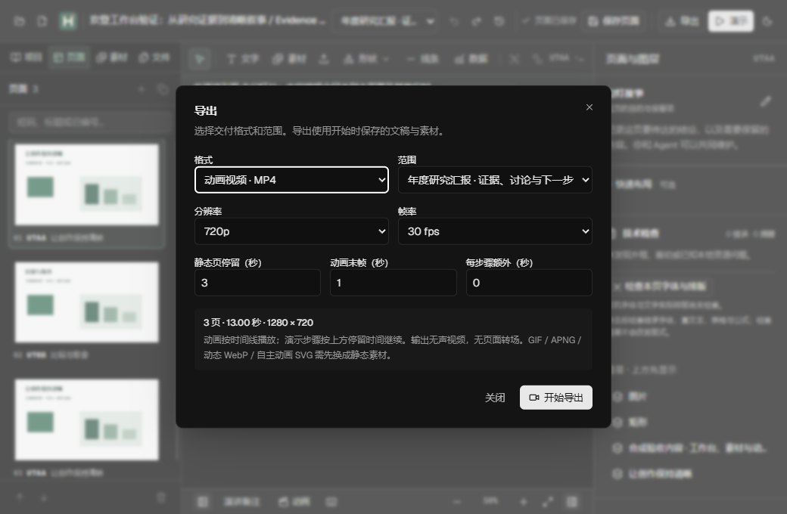

# v0.7 实际验收证据

来源：HUANDENG Editor 0.7.0，运行时 `ba18ac0d95502361fb8a423a732c808218374915`，`sourceDirty=false`，Electron 38.7.2，构建于 `2026-11-07T21:34:36.5584922Z`。

这些是 Windows 最终独立 EXE 的真实运行结果。截图只包含合成内容，文件内只有 IHDR/IDAT/IEND 块，无文本、EXIF、时间或源文件路径元数据；原始截图 SHA-256 与验收报告一致。科研原稿、原项目全屏图和个人路径清单未包含在此目录。

## 实际工作台

项目、集合、保存与文件动作横向组织。画布和作者内容保持主要视觉权重。

工具栏和侧栏进入同一个素材库，设备导入明确放置到当前页。

小窗口在“适合窗口”模式下打开时间轴后整页完整可见，基础属性栏临时让出空间。此时适配约31%，详细编辑面积仍是下一轮工作。

当前集合、分辨率、帧率与静页/末态/cue 时长在同一任务窗口中。Portal 真实按压零位移、普通模式恢复动效另有数值收据。

## 收据入口

| 文件 | 含义 |
| --- | --- |
| [acceptance.json](acceptance.json) | 来源、两平台代码门槛、最终 EXE 十套102项、正式安装和普通用户项目保护摘要 |
| [ui.json](ui.json) | 12项交互、三种窗口尺寸、整页几何、Portal reduced-motion/真实按压、8张原截图身份 |
| [screenshots.json](screenshots.json) | 本目录4张截图像素尺寸、SHA-256及PNG块检查 |
| [video.json](video.json) | 16组视频/静态/协议验收、ffprobe与解码帧位置、取消/重试/不可变下载；路径已脱敏 |
| [benchmark-80pages.json](benchmark-80pages.json) | 80页50pairs逐次反馈/持久化观测与分进程内存；无原稿内容和路径/hash明细 |
| [persistence-control.json](persistence-control.json) | 同一脚本相邻20pairs旧/新包对照，核查前半段写入等待与后半段确认的不同变化 |
| [hd-assets.json](hd-assets.json) | 30页4K有编码器与回退的两组原始阶段量测；只有合成素材，路径/本机服务地址已脱敏 |
| [hd-summary.json](hd-summary.json) | 排除已选中页重复点击后的每轮及90次切页分布、表示大小统计 |

内存原始单位在报告中保留：高清JS/service为bytes，Electron memory为KiB；80页基准JS为bytes，带KiB字段为KiB。表格转换使用MiB。高清“表示总大小”不等于网络总流量；无Content-Length不等于零传输。原始更详细收据、进程日志与失败候选保留在Windows工作树的.verification，来源候选与最终包分别归档。

完整解释、失败修复和未完成项见 [VALIDATION-V07](../../VALIDATION-V07.md)。这里没有宣称数小时内存稳定、全部DPI/视频参数组合已测、真实Agent客户端已安装，或原生PowerPoint动画已完成。
