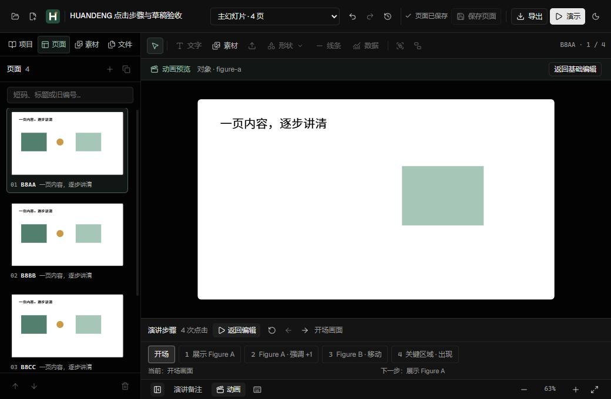
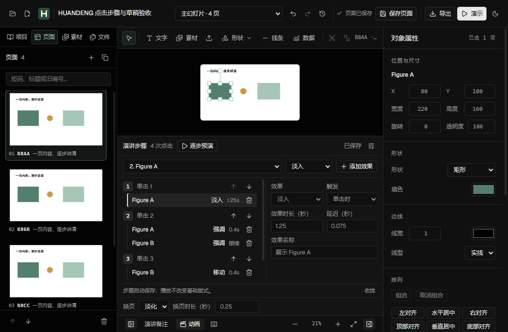

# v0.8 实际界面与验收证据

运行时 `ecba4cb24d2753841290eb5d29f68b702a4902f6`，HUANDENG Editor 0.8.0，Electron 38.7.2，干净构建时间 `2026-11-07T23:44:51.5551681Z`。截图来自最终 Windows EXE 的独立合成项目，DPR 1；不含科研原件、个人路径或 PNG 文本元数据。

## 逐步预演



1040×680 窗口中，预演面板高 103.656 px，完整适配的画布为 **606.833×341.344 px**。作者参数与换页设置在预演中隐藏，返回后恢复输入和展开状态。负责人实际复看截图后才接受这一改版。

## 仍需改进的展开创作状态



基础属性与动画参数同时展开时，小窗口依然拥挤。这张截图保留问题，下一轮应整合为随任务切换的属性面板和可调工作区；不能从预演空间改进推断整个创作界面都已最优。

## 可复核数据

| 文件 | 内容与边界 |
| --- | --- |
| [acceptance.json](acceptance.json) | 运行时标记、代码门槛、131 项最终包检查、安装与原件保护摘要；包含原始收据 SHA-256 |
| [presentation-soak.json](presentation-soak.json) | 25 轮实际放映，逐轮 RAF / DOM 退出状态、WeakRef 回收、进程/JS/DOM 指标；不启用 Network |
| [renderer-runtime.json](renderer-runtime.json) | 80 页副本上的 50 对 GUI 操作，视觉/文件观测/确认时延，自然空闲与最后一次 GC 分开 |
| [observer-control.json](observer-control.json) | 同一 v0.7 EXE、相同 80 页副本和操作，只切换 Network inspector；包括同进程关闭后的对照 |
| [native-allocation.json](native-allocation.json) | v0.7 每十对操作后的 GC 低水位和 native dump 摘要，用于区分容量与活对象 |

完整报告见 [Validation](../../VALIDATION-V08.md)。OS working set、private bytes、JS used 和挂载 DOM 是不同指标，不应混算；原始 memory-infra 的嵌套 provider 也不能简单相加。

### 测试条件及失败记录

两次旧视频兼容脚本在截图阶段超时，均保留为失败。针对性诊断证明前台窗口能正确捕获相同画面，但没有定位原超时的确切根因。最终 `verify-video-v08` 仅在截图前恢复/显示/聚焦自己的测试窗口，保留原来全部 16 项业务检查和截图成功条件，最终通过。不能把这说成产品修复或删除失败记录。

Windows 开发依赖曾因 hoisted 布局出现同版本的两个 React 实例；恢复既有 isolated 开发布局后测试通过，产品和锁文件未因此修改。正式包仍使用独立 hoisted deploy。两项问题分别记在验证报告，不用环境修复冒充业务改动。

原件基线使用本轮已有、通过且 `originalUnchanged` 为 true 的 v0.7 raw-CDP 收据。更早 packaged 基线有一页不同，预检已拦截；当前 82 个哈希均与本轮 raw 基线一致。旧记录与首次预检失败保留，没有回滚原件或推断修改者。私有原件路径、逐页哈希、完整 trace 和进程日志留本机。

## 复现入口

在 Windows 工作树中，将 `HUANDENG_DESKTOP_EXE` 指向待验证的正式 EXE。交互脚本自动创建独立合成项目、profile 和 runtime；真实文稿性能脚本只复制源文稿，然后编辑副本。

```powershell
node scripts/verify-live-v08.mjs
node scripts/verify-builds-v08.mjs
node scripts/verify-keyboard-v08.mjs
node scripts/verify-animation-legacy-v08.mjs
node scripts/verify-video-v08.mjs
node scripts/soak-presentation-v08.mjs presentation-soak-final-25 25
node scripts/diagnose-renderer-v08.mjs "<源文稿的绝对路径>" runtime-final-50 runtime 50
```

视频包内 stdio 验证还需把 `HUANDENG_MCP_CLI` 指向该包内 `resources/app/node_modules/@open-slide/core/huandeng.js`。不提供该变量时，脚本会明确报告没有验证包内 MCP，不能算作完整里程碑证据。运行上述性能命令不要加入 `--trace-memory`、`--gc-every` 或网络检查器；原始脚本支持额外诊断，但那些结果不属于本轮普通运行数据。

25 轮放映和 50 对编辑是有边界的连续使用场景；它们不等于数小时混合高清素材、独立双屏或受控音视频已经完成验收。
