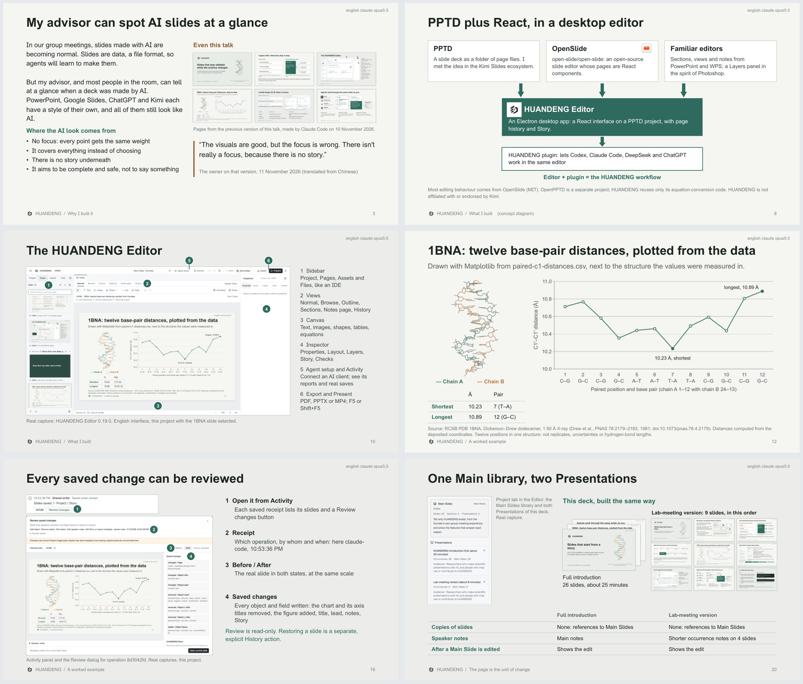
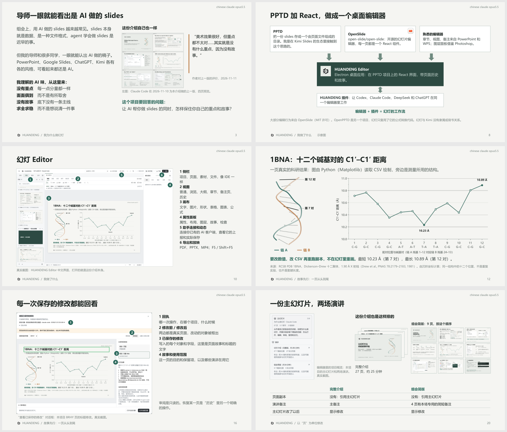
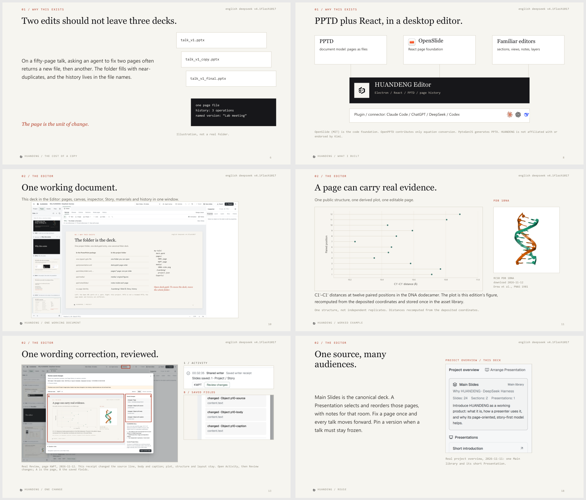
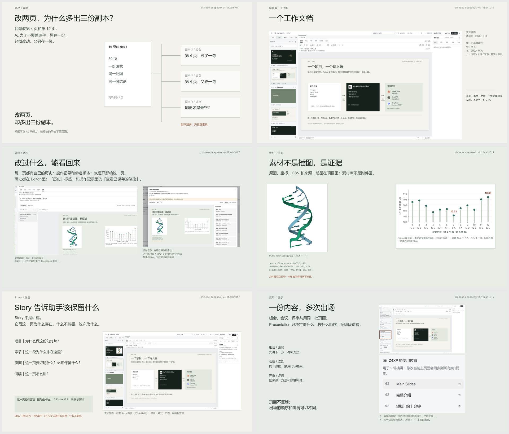

# HUANDENG: the story of a continuing working document
# 幻灯：让同一份工作继续生长

这组可编辑项目从作者的真实经历出发：组会上，完整的 AI 幻灯未必讲清自己想讲的事；五十页里只改两页，却又多出一整份副本。HUANDENG 把作者的故事、原始证据、单页修改和下一场演讲留在同一份工作中。Editor 的操作教学嵌在这些问题的解决过程中，立项原因、架构、设计取舍与致谢共同构成介绍。

These editable projects explain why HUANDENG exists, how its architecture supports continued work, and how to use the Editor in that story. Practical teaching belongs where the audience understands its purpose. The examples are being revised under the [current story contract](../../docs/INTRODUCTION-STORY-SPEC.md); they are not a collection of button-by-button tutorials.

## Current revision / 当前修订

The saved ChatGPT Main sequences contain 28 English pages and 31 Chinese pages. Their shorter Presentations contain 19 and 21 occurrences, including actual title-only Section pages. The primary ChatGPT session personally revised both editions. The Chinese edition retains its earlier subagent baseline and this round's investigative and review assistance. The languages have independent narrative structures. Main/short PDF and PPTX files have been generated for both editions. The Chinese punctuation and wrapping corrections have been re-exported. All four final PPTX files opened and closed read-only in PowerPoint with repair disabled and unchanged file contents. Both ChatGPT editions have completed this round's internal visual and output review; this is not a claim of the author's final acceptance.

Claude Code resumed after the earlier host usage-limit interruption and completed focused native revisions of both editions. DeepSeek Harness completed its own consistency, source and Editor-location revisions. Their current Main sequences contain 26/27 pages for Claude Code and 24/22 for DeepSeek; the shorter Presentations contain 9/9 and 6/12 occurrences. The four sequences and changed key pages completed internal visual review. A 14-file Office baseline passed read-only, repair-disabled checks with correct slide counts and unchanged source files. The final narrow text and Notes corrections then received targeted Office and PPTX Notes XML checks, as detailed in the [current integration record](../../docs/NATIVE-INTEGRATION-0.20.md). These current revisions supersede the earlier watermark-only freeze. The per-edition records distinguish this review from the user's final acceptance.

The existing installed shared writer remains 0.19.0. The [0.20.0 local Editor/plugin candidate](../../docs/RELEASE-V020.md) has been packaged and checked, including its Project Rules view and project-bound acquisition tools. Ordinary Editor screenshots retain their actual 0.19 context; Rules screenshots identify the 0.20 candidate. Packaging did not replace the running writer or publish a public release.

## Choose an edition / 选择一稿

Counts below describe the saved projects during this revision. Export and review status is reported separately for each author. Watermark strings are the exact assigned labels for cover and content pages. Title-only Section pages contain only their title, without a watermark or page number.

| Edition | Main | Short Presentation | Editable entry | Assigned watermark |
| --- | ---: | ---: | --- | --- |
| ChatGPT English | 28 | 19 | [chatgpt-en/deck.pptd](chatgpt-en/deck.pptd) | `english chatgpt 6 astra` |
| ChatGPT 中文 | 31 | 21 | [chatgpt-zh/deck.pptd](chatgpt-zh/deck.pptd) | `chinese chatgpt 6 astra + subagent` |
| Claude Code English | 26 | 9 | [claude-en/deck.pptd](claude-en/deck.pptd) | `english claude opus5.5` |
| Claude Code 中文 | 27 | 9 | [claude-zh/deck.pptd](claude-zh/deck.pptd) | `chinese claude opus5.5` |
| DeepSeek Harness English | 24 | 6 | [deepseek-en/deck.pptd](deepseek-en/deck.pptd) | `english deepseek v4.1flash1017` |
| DeepSeek Harness 中文 | 22 | 12 | [deepseek-zh/deck.pptd](deepseek-zh/deck.pptd) | `chinese deepseek v4.1flash1017` |

## Open and follow the argument / 打开项目，沿着故事阅读

Keep the complete project folder and open its `deck.pptd` in the Editor. Main contains the page library. Use Browse to read the Section rhythm, then return to a page to inspect its Story, original material and Notes. The practical examples connect a focused edit to saved-change review, page identity and history, then show how the same pages serve another talk.

The English full Presentation is **The continuing working document**, with **A shorter introduction** as its shorter sequence. The Chinese versions are **从组会开始的完整介绍** and **一次简短的组会介绍**. Their references, occurrence Notes and version choices belong to the saved project; inspect the arrangement in the Editor rather than relying on an older exported file.

The [unchanged spoken account](story/USER-STORY.zh-CN.md) is the source. [FACTS.md](story/FACTS.md) separates checked product facts from interpretation. [PRODUCT-BRIEF.md](story/PRODUCT-BRIEF.md) describes the current narrative and ownership. Read the [complete acknowledgments](../../docs/ACKNOWLEDGMENTS.md) for code, runtime dependencies, design references and researched alternatives.

## Materials and independent authorship / 素材与独立创作

Each author acquires the new working materials for its own edition. The ChatGPT projects include independently downloaded public structure data, reproducible Python plots and screenshots captured from their own working projects. Same-author reuse between languages is documented in [English source notes](chatgpt-en/sources/SOURCE-NOTES.en.md) and [中文来源说明](chatgpt-zh/sources/SOURCE-NOTES.zh-CN.md). Native acquisition is documented in the [Claude English](claude-en/README.md), [Claude 中文](claude-zh/README.md), [DeepSeek English](deepseek-en/README.md) and [DeepSeek 中文](deepseek-zh/README.md) records.

The Claude English story also cites clearly dated thumbnails of its own earlier draft. That historical draft contains some early shared inputs; those pixels are not claimed as this round's independent acquisition.

The earlier common [scientific package](assets/science/README.md), [reference material](assets/reference/README.md), [brand marks](assets/brand/README.md) and [screenshot library](assets/README.md) remain historical records. They are not a shared input pool for the current independent revisions. A scientific case illustrates how original evidence, a professional plot and editable work stay connected; it does not replace the founder's story.

## Outputs and review / 输出与审阅

Deliver a complete project folder to continue work. Every edition has local Main and short PDF/PPTX outputs at `Exports/deck.pdf`, `Exports/deck.pptx`, `Exports/brief.pdf` and `Exports/brief.pptx`. The native authors also retain their existing named Presentation exports. The 14-file native Office baseline covers four Main, two Claude Full, four named short and four brief-alias PPTX files. The final corrections were checked incrementally; the baseline is not relabelled as a second Office opening of every changed file. DeepSeek English uses Main as its complete introduction; DeepSeek Chinese Full equals Main and has no separate Full export file. Git excludes generated outputs.

The ChatGPT [English Notes](chatgpt-en/speaker-notes.md) and [中文备注](chatgpt-zh/speaker-notes.md) were generated from actual saved Main and resolved short Presentation sequences. Their [English visual provenance](chatgpt-en/sources/visual-provenance.json) and [中文图像来源记录](chatgpt-zh/sources/visual-provenance.json) describe the images actually used by those sequences.

Native saved Notes are available for [Claude English](claude-en/speaker-notes.md), [Claude 中文](claude-zh/speaker-notes.md), [DeepSeek English](deepseek-en/speaker-notes.md) and [DeepSeek 中文](deepseek-zh/speaker-notes.md). They preserve actual Main and formally resolved Presentation Notes, including real occurrence overrides and separate presentation-level Notes where present.

The [current implementation scope](../../docs/PRODUCT-INTRODUCTION-SPEC.md) points back to the story contract. The [earlier validation record](../../docs/PRODUCT-INTRODUCTION-VALIDATION.md) describes the superseded 24-page tutorial revision and its files; it is not acceptance of the current 28/31-page projects. The [current native integration record](../../docs/NATIVE-INTEGRATION-0.20.md) distinguishes candidate packages, installed clients, actual model tool calls, host permissions and native CLI authoring. The [0.19 integration record](../../docs/NATIVE-INTEGRATION-0.19.md) retains its own earlier runtime and task history.

Review follows Audit, Spec, Implement, Validate and Release. It includes the actual narrative and visual relationships, readable Editor orientation, professional data figures, title-only Section pages, complete credits, independent material origins and the final output behavior. A successful export does not establish visual quality or the author's acceptance.

## Previews / 预览

Each overview below shows six selected pages from the current edition. They illustrate the story, architecture, Editor, evidence and reuse; open the complete saved project to read its full sequence.

### ChatGPT English

### ChatGPT 中文

### Claude Code English

### Claude Code 中文

### DeepSeek Harness English

### DeepSeek Harness 中文

Repository MIT terms and upstream notices remain. Scientific material, figures, icons, brand marks and third-party code retain their individual source and license terms. Public release links belong to the exact reviewed candidate; preparation does not change repository visibility or publish a release.
