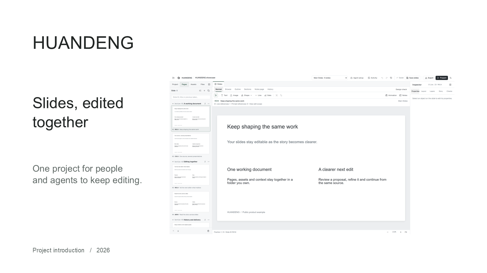
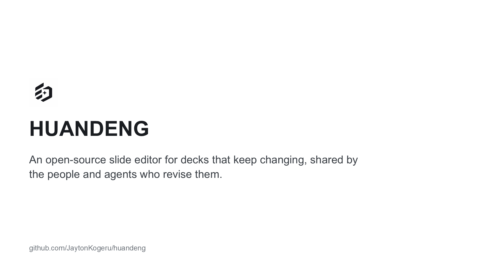

# HUANDENG introductions

四份可以继续编辑的产品介绍，连同原始截图、命名版本与真实工具测试记录。
The introductions demonstrate one editable project shared by people and agents.

## Choose an edition

The ChatGPT editions are the reviewed bilingual product introductions. The other two editions preserve actual native-client trials so the tools can be evaluated honestly.

| Edition | Slides | Editable source | PDF | PowerPoint | Portable project |
| --- | ---: | --- | --- | --- | --- |
| ChatGPT 中文主稿 | 22 | [Source](chatgpt-zh) | [PDF](https://github.com/JaytonKogeru/huandeng/releases/download/editor-v0.18.0/huandeng-chatgpt-zh.pdf) | [PPTX](https://github.com/JaytonKogeru/huandeng/releases/download/editor-v0.18.0/huandeng-chatgpt-zh.pptx) | [ZIP](https://github.com/JaytonKogeru/huandeng/releases/download/editor-v0.18.0/huandeng-chatgpt-zh.zip) |
| ChatGPT English | 22 | [Source](chatgpt-en) | [PDF](https://github.com/JaytonKogeru/huandeng/releases/download/editor-v0.18.0/huandeng-chatgpt-en.pdf) | [PPTX](https://github.com/JaytonKogeru/huandeng/releases/download/editor-v0.18.0/huandeng-chatgpt-en.pptx) | [ZIP](https://github.com/JaytonKogeru/huandeng/releases/download/editor-v0.18.0/huandeng-chatgpt-en.zip) |
| DeepSeek Harness 中文 | 21 | [Source](deepseek-zh) | [PDF](https://github.com/JaytonKogeru/huandeng/releases/download/editor-v0.18.0/huandeng-deepseek-zh.pdf) | [PPTX](https://github.com/JaytonKogeru/huandeng/releases/download/editor-v0.18.0/huandeng-deepseek-zh.pptx) | [ZIP](https://github.com/JaytonKogeru/huandeng/releases/download/editor-v0.18.0/huandeng-deepseek-zh.zip) |
| Claude Code English | 21 | [Source](claude-en) | [PDF](https://github.com/JaytonKogeru/huandeng/releases/download/editor-v0.18.0/huandeng-claude-en.pdf) | [PPTX](https://github.com/JaytonKogeru/huandeng/releases/download/editor-v0.18.0/huandeng-claude-en.pptx) | [ZIP](https://github.com/JaytonKogeru/huandeng/releases/download/editor-v0.18.0/huandeng-claude-en.zip) |

## Continue editing

1. Download a portable project ZIP and extract the entire directory.
2. Open its `deck.pptd` in HUANDENG Editor 0.18.0.
3. Keep `pages`, `media` and `.huandeng` beside the manifest when moving or sharing the project.
4. Choose Main or a Presentation to edit, present or export.

Both ChatGPT editions include the full 22-slide presentation, an 8-slide short presentation, speaker notes, Story and a named visual-review version for every page. Their title-only section pages are at positions 3, 8 and 17. Backgrounds are white throughout.

PPTX exports contain editable native text; UI screenshots remain image objects. PDF and PPTX represent static slides. Temporary Undo and operation journals are local runtime state; portable named versions travel with the project directory.

## Preview

### ChatGPT 中文

### ChatGPT English

### DeepSeek Harness 中文

### Claude Code English

## Evidence and assets

- [Organized screenshot library](assets/README.md): 120 original captures, including 37 recommended task images, with language, original dimensions and SHA-256 provenance.
- [Portable evidence projects](evidence-projects/README.md): real bilingual source projects, focused before/after edits, stable-identity reordering and named-version evidence.
- [Slide validation](../../docs/VALIDATION-V018-SLIDES.md): independent visual review, actual Office/PDF checks and portability.
- [Native-client trial report](../../docs/VALIDATION-V018-NATIVE-TRIALS.md): exact trial scope, interventions and remaining weaknesses.
- [Release manifest](../../docs/evidence/v018/release-manifest.json): archive sizes, hashes, source identity and edition metadata.

Full windows were captured at native DPR2 and focused task regions at DPR4. These are actual editor states, with Chinese UI/content and English UI/content captured separately. No interface artwork was reconstructed and no bitmap was enlarged to create resolution.

## Native trial boundaries

Claude Code authored its 21-slide English introduction in its native client. Its first submission is preserved. It is a relatively complete product introduction; the History slide retains an early screenshot with no named versions, and one old operation preview references a crop that the model removed. Current pages and all 21 portable named versions have their assets.

DeepSeek Harness authored 21 Chinese slides. A native shell-permission initialization failure blocked its original asset work. A supervisor imported the exact supplied public assets through the supported asset API, then continued the same native session. Only four slides changed. The first text-only submission remains preserved in the local trial archive; this release contains the clearly identified technical-continuation result. Its three UI crops retain Chinese chrome with English example content, and its visual evidence is less complete.

Neither native output received a cosmetic rewrite by the integration owner. Both final PowerPoint files were subsequently checked in actual Microsoft PowerPoint. This added export acceptance is separate from what each model did itself.

All four editions passed portable project checks and have matching PDF/PPTX page counts. PowerPoint 16.0 opened and exported all 86 slides read-only without repair or source changes. The ChatGPT PDFs were also rendered and visually inspected across all 44 pages.

## License

These are public product examples under the repository's MIT license. Upstream OpenSlide attribution is retained. Screenshot and evidence bundles include their own license and provenance records. The repository's publication visibility is controlled separately from the examples.

## Source integrity

Portable documents, named checkpoints and provenance manifests retain their original bytes. The scoped Biome configuration disables only reformatting of this authored-data collection; parsing and linting remain enabled. The local Git attributes prevent line-ending conversion so a checkout can still match the recorded project and asset hashes.
