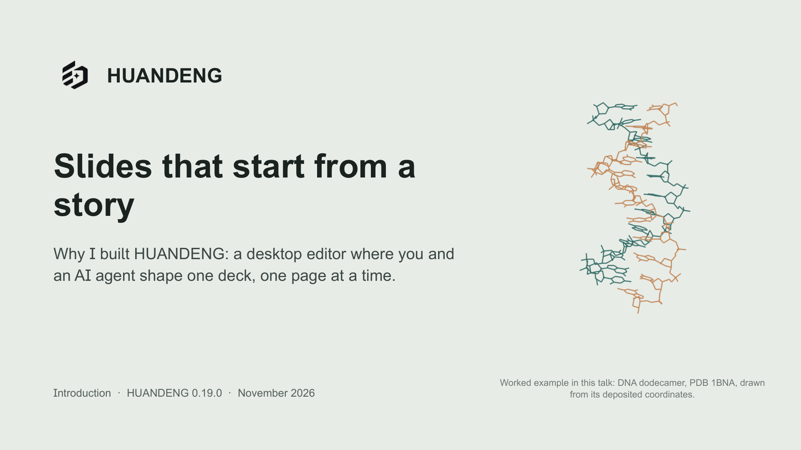

# HUANDENG: Claude Code English introduction

Open [deck.pptd](deck.pptd) in the Editor and keep the complete project folder together.

This edition explains why HUANDENG began, how a page becomes the unit of continued work, and how the Editor supports that argument. Native Claude Code (Opus 5.5) made the focused revisions through the official HUANDENG CLI and the existing shared writer. The successful story and visual system were retained.

## Current saved edition

| Collection | Pages | Version and Notes behavior |
| --- | ---: | --- |
| Main | 26 | Five actual title-only Section pages. |
| HUANDENG introduction (full, about 25 minutes) | 26 | Same order and resolved Notes as Main; live references, no pins. |
| Lab-meeting version (about 8 minutes) | 9 | Live references, no pins; four occurrences have their own Notes. |

Cover and content pages carry `english claude opus5.5`. Section pages contain only a title on their plain background.

The [saved speaker notes](speaker-notes.md) have been checked against the actual Main and both formally resolved Presentations. Their 61 Main/Full/Short entries preserve the saved text and order. The short scientific explanation correctly describes a Matplotlib figure regenerated from data or a script.

## Evidence and the worked example

The current scientific figures, identity marks and instructional Editor captures were independently acquired for this edition. The [acquisition record](sources/independent-20261111/ACQUISITION.md) documents the public PDB download, original marks, actual 0.19 Editor captures and previews rendered from this project's own pages.

PPKK also shows six explicitly dated thumbnails of this author's 10 November draft as evidence for the criticism of that earlier version. Those historical pages contain some early shared inputs. They are retained as historical evidence, not claimed as this round's independently acquired material.

The scientific plot comes from [the Matplotlib script](sources/independent-20261111/science/plot_c1_distances.py) and its retained CSV. Replacing the slide chart with that professional figure is the worked example. The Review comparison on 6FNH shows the real operation `8d3042fd`; its Before state already used this author's independently acquired structure and marks. The redundant comparison arrow was removed. The relationship diagrams retain their nodes and logic with graphical connectors, and formal acknowledgments remain in the sequence.

## Review and outputs

The current 26-page sequence and affected relationship/comparison pages have completed this round's internal visual review. Independently, PowerPoint opened Main (26), Full (26), Lab-meeting (9) and the brief alias (9) read-only with repair disabled. All four source files were unchanged. This output check and the internal visual review do not assert the owner's final acceptance.

The native author regenerated Main, Full and Lab-meeting PDF/PPTX outputs after the final changes. Canonical local files are `Exports/deck.pdf`, `Exports/deck.pptx`, `Exports/brief.pdf` and `Exports/brief.pptx`; named Full/Lab outputs are also retained. Git excludes generated exports.

The current six-page overview is in the [collection index](../README.md). Existing source notices remain with the project. Older `MEDIA-INPUTS.json`, product evidence and shared-input records describe their own revisions; current active acquisition is identified above.

## Earlier records

The preserved material below includes the old 25-page edition, watermark-only scope, native-chart limitations and then-reported checks. Those statements apply to their recorded revisions and do not override the current state above.

Preserved native author report and earlier revision history

# HUANDENG · Claude Code · English product introduction

## Self-review and independent-acquisition revision (11 November 2026)

This is the current state. The owner was satisfied with the previous edition. In a follow-up task, Claude Code (Opus 5.5) audited it against the current [AGENTS.md](AGENTS.md) and made focused improvements through the shared writer. The story, section structure and visual system are unchanged. Main now has **26 pages**: the full Presentation has 26 and the Lab-meeting Presentation has 9.

- **Watermark and dividers.** Every cover and content page carries the exact text `english claude opus5.5`. The five Section dividers now show only their title. Middle-dot separators were removed from authored text.
- **Independent artwork.** The active art was acquired again for this edition. 1BNA was downloaded from RCSB, its distances recomputed and its structure redrawn; all twelve values match. Marks come from official sources. All UI captures are real HUANDENG 0.19.0 screens of this project. See [the acquisition record](sources/independent-20261111/ACQUISITION.md).
- **The data plot is now a Matplotlib figure, and that change is the worked example.** The owner's feedback was that data plots must be drawn with professional tools such as Python packages, from the data, rather than built inside the slide, because in-slide charts are a major source of the AI look. Operation `8d3042fd` replaced the native chart on the 1BNA slide (AVNM) with `c1-distances-1bna.png`. The script `sources/independent-20261111/science/plot_c1_distances.py` draws that figure from `paired-c1-distances.csv` at its true slide size and also writes SVG and PDF. Values, axis range, citation and the extremes table are unchanged, and PowerPoint now shows exactly what the editor shows. Section 3 follows this one real change: its Story, Outline, before/after from the Review dialog, Review and History all come from this project. Named versions record the state before and after. The earlier axis-label patch on the native chart (`9c021a9e`) stays in the slide's history.
- **Acknowledgments.** New slide 9JFE restores the formal credits, grouped by relationship: code, origin of the idea, design references and researched alternatives.
- **Smaller fixes.** Two all-bold paragraphs flagged by Design check are now regular weight. The 1BNA axis title no longer overlaps the labels in PowerPoint. Counts and slide-ID examples now match the deck.

Operations: `2afaf784`, `9c021a9e`, `82a16694`, `6dd7f068`, `25592fd7`, `7a376746`, `1284a12d`, `a186f8c4`, `80538e4f`, `6a5c6224`, `b1f10c78`, `a232e906`, `57e996e3`, `ff236ae6`, `dee23f5a`, `1cd986dd`; then `8d3042fd` (Matplotlib figure), `dd2f2a0f`, `af45507e`, `6423689c`, `c76fb496`; finally `be22b4a4`, which removed the thin `arrow` line between the Before and After images on 6FNH after reviewer feedback. Main and the full Presentation were re-exported after that removal; the Lab-meeting outputs do not include 6FNH and were not changed. After a later review, operation `ac9194c7` replaced the thin line arrows on RQ64, C45U, TFJB and AUBX with filled block arrows. These use the editor's native `rightArrow` and `downArrow` shapes and keep the nodes, order and content. On TFJB and RQ64, the diagonal connectors became straight arrows into the same targets. On AUBX, the version-specific "22 MCP tools" became the stable phrase "Tools and guides for each step". Operation `ed96eecd` pointed the thumbnail grids on 7NHP and JZ7U at new `r5-*` renders; the earlier `r4-*` files are kept. Neither Presentation has pins, and both resolve their live references to these revisions. Main, the full Presentation and the Lab-meeting Presentation (including `brief.*`) were re-exported, and the PPTX files were checked in PowerPoint 16. All exports were regenerated. The final Main PPTX was rendered in PowerPoint 16 and all 26 slides were inspected. Remaining advisory items:

- BW88 is title-only but draws its background as a full-bleed rectangle, so the divider check flags it. Its Story asks to keep this page identity, so it was not replaced.
- The V2SV status-bar crops are slightly upscaled.
- Some short bold headings are flagged as information only.

This agent review is not owner acceptance.

## Final watermark-only revision (historical)

The owner froze this edition’s content and visual design. Its native author added one editable attribution object to every Main page: **English · Claude Opus 5.5**. Main has **25 pages**; the authored Brief has **9 occurrences**.

An independent full-data comparison confirmed that all original page objects, Notes, page order, metadata, Presentation arrangements and scientific values remain unchanged. Final PDF/PPTX files were regenerated mechanically from that saved source. See the [current collection](../README.md), [freeze evidence](../../../docs/evidence/final-examples/native-watermark-freeze.json) and [final validation](../../../docs/PRODUCT-INTRODUCTION-VALIDATION.md).

The records below document the earlier native authoring and reviews. Their original outcomes and retained limitations remain historical; this watermark pass does not constitute another content rewrite.

The native author completed this revision in the original session. The coordinator assembled this index, exact saved Notes and read-only evidence; it did not rewrite authored pages, Story or metadata.

[PPTD project](deck.pptd) · [Main PDF](Exports/deck.pdf) · [Main PowerPoint](Exports/deck.pptx) · [9-page Brief PDF](Exports/brief.pdf) · [9-page Brief PowerPoint](Exports/brief.pptx) · [Saved speaker notes](speaker-notes.md)

**Main: 25 pages. Full Presentation: 25. Brief: 9 pages, four occurrence Notes, no pins.** This is a preserved native candidate, not owner acceptance.

## What changed and who did it

The preceding completed native task made 18 tool calls. A separately scoped factual continuation made 27 calls in the same session, preserving account/model and the existing design. It corrected the screenshot-measurement and Story-guarantee claims in visible text, relevant Notes and Story. This was a content-correctness gate, not a taste-based rerun or first-pass approval.

The English continuation also aligns current 0.19 release labels, the file-or-folder opening rule and actual DSH + ChatGPT collaboration facts. AVNM and 7NHP remain byte-identical to the protected user-edited baseline, including AVNM’s table height 75.567. The existing 25-page structure and art are retained.

The native author exported all four final Main/Brief PDF/PPTX artifacts. Their reports and resolved Notes match the saved source. The coordinator only standardized any title-based Brief filenames without changing native bytes. Earlier export provenance is retained separately; the preceding English Brief had been mechanically exported by the coordinator, and is not confused with these final native artifacts.

## Verification scope and retained limits

The preceding complete 25-page deck was actually rendered read-only in PowerPoint 16.0 and reviewed in full contact sheets plus selected full pages. After this factual continuation, only the changed pages were visually rechecked and targeted current Office renders were inspected. Unchanged pages are linked by identical source hashes to the prior evidence; this is not a claim that every page of the new PPTX was rendered again.

**Known Office limitation:** preceding actual Main page 12 and Brief occurrence 5 show native numeric X-axis placement misaligned with manually positioned pair labels, and a long axis explanation presses into the tick line. AVNM’s source is unchanged, so the limitation remains disclosed; no full PowerPoint visual pass is claimed. Its PDF/Editor appearance is readable. The ordinary gaps list on page 24 also remains a one-column native table under the explicit art-preservation scope.

All twelve native chart values in final Main and Brief match the public CSV exactly. Main PPTX retains one native chart and eight native tables. Current Brief PDFs and all nine resolved Notes were verified; Main-numbered footers remain in the Brief. No new complete Brief Office pass is claimed.

The language pair now carries corresponding core product claims, evidence, use steps and boundaries. Chinese uses an additional dedicated collaboration page; English covers the same verified facts in the existing agents explanation and Notes. A real DSH + ChatGPT fixture is evidence of coordinated revision-checked saves, not a native Claude collaboration test, online presence, section locks or automatic scheduling. [Independent correspondence](evidence/product-pair-review.json).

## Evidence and use

[Current native trial](evidence/product-trial.json) · [Current QA](evidence/product-qa.json) · [Independent review](evidence/product-review.json) · [Prior full-sequence evidence](evidence/product-prior-stage.json) · [Brief provenance](evidence/product-brief.json) · [Native values](evidence/product-science-check.json) · [Image use](evidence/product-assets.json) · [Visible final author report](evidence/product-native-author-report.md)

Keep the whole directory when moving the project. deck.pptd is the entry; pages, media and metadata belong together. [Sources and notices](SOURCES.md), [public input manifest](MEDIA-INPUTS.json) and [technical facts](sources/story/FACTS.md) preserve provenance. The 1BNA example measures twelve positions of one public structure, not experimental replicates or a product benchmark.

Existing unprefixed evidence describes older submissions. Its counts/hashes remain historical, not claims about current exports. Archived before-product README/Notes preserve exact bytes and retain the original project-root relative-link origin.

Existing miniature page previews retain their original snapshot bytes; only the actual affected page bodies were refreshed in this wording-only maintenance.

