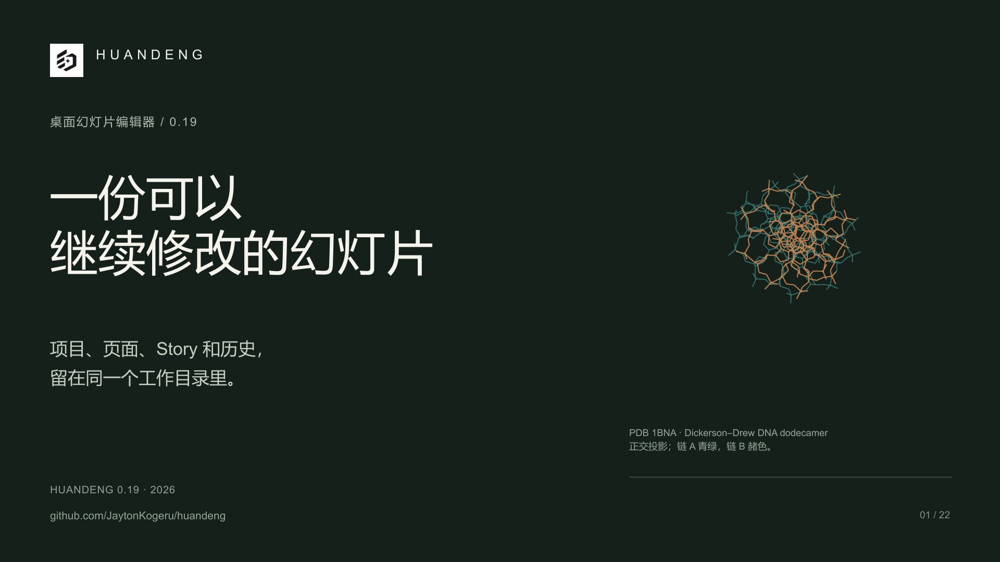

# HUANDENG：DeepSeek Harness 中文介绍

[可编辑项目](deck.pptd) | [Main PDF](Exports/deck.pdf) | [Main PowerPoint](Exports/deck.pptx) | [12 页简版 PDF](Exports/brief.pdf) | [简版 PowerPoint](Exports/brief.pptx) | [实际保存的讲稿](speaker-notes.md)

本稿从组会要讲什么、修改两页为何留下多份副本出发，用 Story、单页身份与历史、证据保存和下一场演讲的复用解释 HUANDENG。原生 DeepSeek Harness 保留现有视觉系统，完成一致性、独立素材和 Editor 位置引导的局部修订。

## 当前保存的版本

| 集合 | 页数 | 页面与备注行为 |
| --- | ---: | --- |
| Main | 22 | 两张实际标题独占章节页，完整致谢保留在 K9P9。 |
| 完整介绍 | 22 | 与 Main 同序、同页面备注，全部引用当前页面，没有 pin。 |
| 简版 | 12 | 全部引用当前页面，没有 pin 或单次引用备注覆盖，继承 Main 的实际讲稿。 |

完整版与简版各有独立的演讲级备注。完整版说明从组会需要、Story、一次只改一页、1BNA 证据保存走到下一场演讲；简版说明复用 Main。它们和页面 Notes 是不同层级，[讲稿文档](speaker-notes.md)分别保留实际内容。

封面和内容页使用精确水印 `chinese deepseek v4.1flash1017`。章节页只保留标题，不附水印或页码。

## 独立素材与 Editor 引导

本轮结构图与原始坐标来自作者自己的公开来源获取，距离重新计算，曲线使用 Matplotlib。原始 URL、时间和来源保留在[独立获取记录](sources/independent-2026-11-11/acquisition.json)，获取与派生方法见[acquire.py](sources/independent-2026-11-11/acquire.py)及[derive_crops.py](sources/independent-2026-11-11/derive_crops.py)。

品牌素材由本版作者自行取得，见[品牌采集记录](sources/brand-acquisition/brand-acquisition.json)。原来共同输入的科学图和界面库保留为历史，不是本轮的新素材输入。

XZJN 的复用说明保留本项目完整 Editor 窗口，在原窗指出项目面板中使用位置的区域，再展示同源可读细节。[定位来源记录](sources/xzjn-location-2026-11-11/xzjn-location.json)保留该对应关系。真实界面保留实际运行的 0.19 版本，不把新工具路由称为已升级的桌面。

[本轮原生集成记录](../../../docs/NATIVE-INTEGRATION-0.20.md)说明实际运行组合：已安装的 0.19 DSH 适配器、显式绑定的 0.20 MCP CLI，以及未替换的 0.19 writer，并区分真实模型调用与单纯安装成功。

## 审阅与输出

当前 22 页完整序列、科学证据和 XZJN 的位置引导已完成本轮内部视觉复查。Office 基线检查以禁用修复的只读方式打开 Main（22 页）、按名称导出的简版（12 页）及 brief 别名（12 页）。最后将 UGA7 改为忠实转述，并纠正 5ZZM 的 manifest/metadata 讲稿事实后，重新只读打开 Main，核对第 4 页的转述卡片。最终 Main 第 4/19 页与简版第 3/11 页的 PPTX Notes XML 也已核对；简版别名与正式文件逐字节一致，没有重复 Office 打开简版。所有检查均未改变被读取的文件；内部复核不代表用户最终验收。

本地 `Exports/deck.pdf`、`Exports/deck.pptx` 对应 Main；完整版与 Main 完全相同，未另造一套 Full 输出。简版保留按演讲名称导出的文件和 `Exports/brief.pdf`、`Exports/brief.pptx` 别名。演讲级备注保存在项目与 Markdown 中；这些 PDF/PPTX 不包含该层备注。生成的导出不进入 Git。

当前六页选览见[项目集合入口](../README.md)。移动时保留整个项目目录，包括入口、页面、原图、来源、元数据与历史，不单独移动 `deck.pptd`。

## 历史记录

下面保留此前水印冻结、旧素材与旧输出的说明。它们只描述当时的状态；旧水印、旧页数、旧检查范围和旧内容问题不作为当前版本的规则或验收结论。当前保存的项目与上文列出的来源、正式解析 Notes 和输出范围优先。

保留的早期原生交付与复核记录

# HUANDENG · DeepSeek Harness · 中文产品介绍

## Final watermark-only revision

The owner froze this edition’s content and visual design. Its native author added one editable attribution object to every Main page: **Chinese · DeepSeek V4.1 Flash 1017**. Main has **22 pages**; the authored Brief has **12 occurrences**.

An independent full-data comparison confirmed that all original page objects, Notes, page order, metadata, Presentation arrangements and scientific values remain unchanged. Final PDF/PPTX files were regenerated mechanically from that saved source. See the [current collection](../README.md), [freeze evidence](../../../docs/evidence/final-examples/native-watermark-freeze.json) and [final validation](../../../docs/PRODUCT-INTRODUCTION-VALIDATION.md).

The records below document the earlier native authoring and reviews. Their original outcomes and retained limitations remain historical; this watermark pass does not constitute another content rewrite.

本项目由原生 DeepSeek Harness 独立修订。协调者整理当前入口、保存的讲稿与核验材料，并机械导出作者已保存的简版；没有改写原生页面、Story、Notes 或 Main 成品。

[PPTD 项目](deck.pptd) · [Main PDF](Exports/deck.pdf) · [Main PowerPoint](Exports/deck.pptx) · [12 页简版 PDF](Exports/brief.pdf) · [简版 PowerPoint](Exports/brief.pptx) · [实际保存的讲稿](speaker-notes.md)

**当前 Main 22 页；full 22 页；brief 12 页。** full 与 Main 同序、同页面、同讲稿。brief 选择 Main 的 1、2、4、5、6、8、13、15、16、17、19、22 页，全部引用当前页面，没有 pinned version 或独立 occurrence Notes。它继承 Main 的实际讲稿，没有另写一套短版脚本。

这是保留具体内容局限的原生候选，不代表作者已接受。

## 实际完成与交付边界

本轮使用正式安装的 HUANDENG 0.19.0 headless 原生包，在原来的中文会话完成。该轮原生工具轨迹、配置来源与实际完成状态见 [current trial](evidence/product-trial.json)。没有更换模型、账号或扩大权限。

原生作者导出了当前 22 页 Main PDF/PPTX；报告与保存的 source revision 一致。协调者用 PowerPoint 16.0 只读打开独立副本并渲染 22 页，原文件和副本 SHA 均未改变。全部四张 Office 联系图，以及 8、10、11、13、14、15、16、19、20、22 页全尺寸画面已实际审读；该范围内未发现新增裁切、缺图或原生表格溢出。

Main PPTX 含 22 页 Notes、三张原生表格和 20 个媒体部件。科学曲线与真实界面是原始图像；这份稿件没有原生 chart。字体未嵌入的导出 advisory 保留在原报告中。

作者已更新保存的 brief 为 12 页，但原生提交仍留着上轮 11 页简版导出。协调者保留旧文件字节后，机械导出当前 12 个 authored occurrences；页、顺序、讲稿与 pin 状态均未改。新简版已核对报告、12 页 PDF/12 页 PPTX、逐页 Notes 和 PDF 联系图；没有声称另跑了一轮简版 PowerPoint。见 [brief export evidence](evidence/product-brief-export.json)。

简版封面仍保留 Main 的固定页码“01 / 22”。这是原生页面遗留的文字；简版实际为 12 页，协调者没有为修正这个数字改写源页。

## 署名水印

本版在 Main 的 22 页和 brief 的 12 个出场页右上角加入可编辑文本“Chinese · DeepSeek V4.1 Flash 1017”。除这一署名外，正文、Story、Notes、页面身份、科学数值和演讲选择未改；`Exports/deck.*` 与 `Exports/brief.*` 已按当前 revision 重新导出。

## 保留的内容问题

- 第 4 页使用“这是 AI 做的吧？”并在讲稿中归为导师原话。用户只描述了识别 AI 风格的现象，没有提供这句逐字对白；当前稿未标明这是改写或示意。
- 第 19 页把 Story、章节和“顺序”一并归入 metadata revision。Main 页面顺序属于 manifest revision；Presentation 内部顺序才属于 metadata。英文稿也保留了同一错误。
- Project/Section Story 已更新，但个别 page Story/Notes 仍旧：封面的 requestedChange 还写从 16 页产品版改为 18 页故事版；第 16 页实际展示同一页两个文字字段的变化，purpose 却仍写“改两页”。
- 中英语义对应已覆盖大部分产品主题，但中文未讲清英文的可选命名版本 pin，也没有对应 MP4 的定时点击构建、分辨率和无音频限定。中文截图中能看到 MP4 入口；这不等于已作可用说明。浏览/大纲的不同用途也比英文解释得少。

这些是内容、元数据和对应范围的问题，不是原生客户端或 Office 渲染失败。协调者没有改写这些页面，也没有要求作者按美术偏好重做。

用户指出的 XZJN 散文碎片问题已实际修复：三种场合的文字在一个 rich-text 对象中。第 4 页三组观察、第 15 页 Story 层级说明也各是一个文本对象，不能仅因视觉分行误判为假表格。三张原生表格表达的均是真实二维关系。

[独立审读](evidence/product-review.json) · [实际 Story 与 Notes](evidence/product-narrative.json) · [独立语义对应审读](evidence/product-correspondence-review.json) · [原生对应记录](SEMANTIC-CORRESPONDENCE.zh-CN.md) · [原生最终答复](evidence/product-native-author-report.md)

原生对应记录把“副本问题”的中文页码写成 5，实际是 Main 6；原记录保留原字节，独立审读使用实际位置。

## 使用与来源

移动时保留整个项目目录，包括 deck.pptd、pages、media、.huandeng、来源文件和说明。不要只复制入口文件。

[当前图像使用表](evidence/product-assets.json) · [公共素材输入](MEDIA-INPUTS.json) · [来源与声明](SOURCES.md) · [技术事实](sources/story/FACTS.md)。1BNA 的十二个配对位置属于同一结构，不是独立重复实验或产品性能比较。

截图沿用公开的 0.18 中文界面并在页内注明；产品封面与入口功能写 0.19。没有把旧截图冒充为新版本实拍。原图字节和来源保留。

## 历史材料

原有 evidence/native-trial.json、qa.json、content-review.json、short-exports.json 等未加 product- 前缀的材料属于此前 18 页 Main / 11 页简版试作，其旧 hash 和页数不能用于声明当前 Exports 文件已验收。本轮以 product-* 材料为准。

[原生当前 README 原件](evidence/product-native-README.md) 保留作者原字节，其相对链接以原位置“项目根 README.md”解释；当前可用入口是本文件。上轮讲稿也作为历史材料保留。

